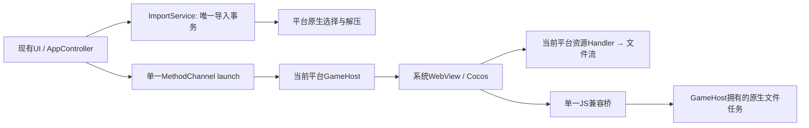

# 实际功能、唯一实现与数据流审计

本文件是下述 Git 基线的历史审计，不代表当前待办。2026-10-15 的运行时收敛和无用代码清理已经实施；当前归属与验证结果见[实施记录](runtime-convergence-implementation.md)。

日期：2026-10-14。权威基线：当前工作树`b6152704b22e2137efa4da1a542f76c6eb896ca8`；关联提取项目`codex/dom-metadata-preload@1ffb59b061761ccee1592097abc78c63fc9a6bda`。当前UI保持，Android、iOS、纯血鸿蒙完整保留；两仓各自的一键Actions保留。

本文件区分**当前真实实现**、**冗余证据**与**收敛决定**。本轮只审计源码和修订文档，没有重构生产代码或执行文件删除。行号对应上述基线；来源代号在第11节给出可点击文件链接。

## 1. 判断标准与最小架构

用户任务只有两件：导入一个可用游戏包，然后稳定运行它。其余能力是这两件任务的具体输入、输出和状态：文件选择、保存、触摸、音频、日志、更新。不能因它们能起名字就各加一层Manager/Provider/Repository/Router。

采用以下规则：

1. 一个功能只有一个生产所有者、一个选定执行路径；公开别名在入口归一一次，不向下复制分支。
2. 只有跨语言、跨进程或系统API差异才保留适配层。三端系统实现不可互换，不再在Dart为它们建一个没有选择作用的Router。
3. 内容就绪、权限校验、事务提交和失败结果是功能本身；保留这些保证。尝试失败后换另一套播放器、传输、数据源或安装器是运行时兜底，目标架构不采用。
4. 数据到消费者所必需的位置才转换一次。路径/句柄留Native，游戏文件字节不经过Flutter；统计不携带标题，诊断不再复制一套资源状态。
5. UI widget传对象引用、平台必要的会话元数据编码、单测注入替身，不能凭“层数”认定为大数据复制或多生产实现。

目标保持三条直接链路：



ImportService承担实际状态机；GameHost承担实际WebView、选择器和任务生命周期；JS桥承担一次参数/结果转换。它们有真实工作，不再外包一层PackageStore、SessionCoordinator、PlatformHost、FileWorkspace再逐级转发。

## 2. Flutter实际产品功能接口

下列是生产用户意图/启动入口。展开、筛选、弹窗属于现有UI本地状态，不新增业务服务。

| ID | 功能/入口 | 当前唯一实际实现与证据 | 收敛决定 |
| --- | --- | --- | --- |
| F01 | 应用初始化 | `main.dart:78 → AppController.initialize`，D1:228；路径、退出结果、设置、清单、恢复、版本与资源检查 | 保留一个初始化位置，完成后再发更新检查 |
| F02 | 显示资源/日志/关于 | U1:164/173/182，`_selectedSection`、对话框、本地state | 保留现有一套UI；不新增导航样式 |
| F03 | 选择并导入/更新游戏ZIP | U1:75/1727 → D1:525 `importResources` → D2:44 `beginImport` → D3:26 `pickAndExtractDocsZip` → D2:85 `completeImport` | 一个导入事务；Native接收文件，Dart只接路径/进度 |
| F04 | 取消选择/失败导入 | D1:586/695/743 → D2:67 `abortImport`；completeImport激活前失败由D2:225–244回滚后抛出；激活后旧槽清理失败由D2:209–224保留新槽、返回待清理manifest并报告成功 | 同一事务的结束分支；不能回滚已提交的新资源 |
| F05 | 导入进度、速度、耗时 | D1:776/802 → D4:17 `ImportProgressMeter.measure`；U1:1385/1511显示 | meter做实际计算，保留一个；进度只上传计数 |
| F06 | 展开/关闭进度 | U1:98/111；D1:811/850 手动/定时复位 | 复位用同一私有函数；本地bool不进入持久化模型 |
| F07 | 复制资源目录 | U1:232/1664 → `Clipboard.setData` | 不经过Native文件桥 |
| F08 | 开始游戏 | U1:151 → D1:871 → D5:241 `MethodChannelGameHost.launch`（中间当前有Router） | 去掉无选择作用的Router，直接发一次启动请求 |
| F09 | 启动前检查 | D1:875 → D6:9 `ResourceValidator.validate` | 检查当前时间的文件现实；不同于同一导入结果反复验证 |
| F10 | 返回/异常退出后恢复启动器 | D1:235 → D7:90 `consumeExitResult`；原生写退出结果 | 保留sessionId关联和恢复；仅保存需要的恢复数据 |
| F11 | 展开启动设置 | U1:2142/2334 本地bool | 保持现状 |
| F12 | 自动收集偏好 | U1:2197 → D1:1102 → D8 `ManifestStore.write` → 下一GameSession | 单一写者；**成功导入重置为off是既有产品规则**，不能误报为bug |
| F13 | 详细音频诊断偏好 | U1:870 → D1:1073 → D9 `AppSettingsStore.write` | 当前UI唯一入口；Android/OHOS尚未接入，不写成已全平台可用 |
| F14 | 检查加载器更新 | U1:44/1158 → D1:417/461 → D10:77 `checkForUpdate` | 保留release产品解析；版本身份只读一次 |
| F15 | 检查游戏更新 | U1:1169 → D1:476 → D11:151/179 `check/loadLatestVersion` | 保留tags/稳定版规则；与F14不是同一产品的双实现 |
| F16 | 本次推迟某类更新 | D1:509/517，保存对应tag | 两个不同产品的提醒状态，各一份 |
| F17 | GitHub/网盘/公告等外链 | U1:137/141/145 → `external_browser/open` | 所有启动器外链共用一个入口；不与游戏沙箱白名单混成一套权限 |
| F18 | 刷新公告 | main:82 → D1:404 → D12:43 `fetchCurrentAnnouncement` | 一个HTTP解析入口；失败显式无新公告，不用另一份假“当前公告” |
| F19 | 关于正文、远端版本刷新与离线有效内容 | main:81 → D1:409 → D13:51 `refreshContent`；U1:182显示 | 缓存作为一个本地有效事实源，远端刷新只更新它，首次由bundle种入；去解析失败后换常量的伪成功，不删除离线缓存功能 |
| F20 | 刷新日志 | U1:173/827 → D1:959 → D14:116 `loadSnapshot` → Native snapshot | Native唯一事实源 |
| F21 | 筛选日志 | U1:693 `_visibleEvents`；D1:999 `buildLogText`另有等级表/过滤 | 同一个小型过滤函数，不建LogQuery层 |
| F22 | 展开/复制单条事件 | U1:704/1009/1036/1054/1061 | 显示状态留UI；只在展开详情或复制时pretty JSON |
| F23 | 复制完整诊断 | U1:198 → F20 → D1:1020 `buildDiagnosticSummary` | 一个格式化入口；明确复制全部近期事件，保持现语义 |
| F24 | 清历史日志 | U1:210确认 → D1:974 → Native `deleteHistory` | 当前能力存在；本审计未执行；清理归Native唯一实现 |
| F25 | Flutter错误/生命周期日志 | main:18/31/49/95 → D14:66 `emit` | Dart构造事件、Native统一排序/脱敏/存储；不另存Dart镜像 |
| F26 | 操作耗时日志 | D14:97 `startOperation` → D15:303/430 `InMemoryAppLogger.startOperation/_InMemoryLogOperation.run` | 开始/终态/耗时是实际逻辑；可保留一个帮助函数，不作为另一日志后端 |
| F27 | 横屏/沉浸模式 | main:42/43 与 U1:39/40重复设置SystemChrome | 由应用启动位置设置一次 |
| F28 | 消息显示 | U1:117，`message/_lastMessage` → Snackbar | 保持现有UI；删除无调用的公开clear入口是后续代码项 |

### 2.1 Dart服务接口与实际数据归属

| 当前接口 | 实际实现 | 结论 |
| --- | --- | --- |
| `AppPathsService.ensureInitialized` | D16:32，path_provider得到根，建立槽/GP目录 | 保留；每平台默认根列表只有一个元素，List+循环重试没有生产多选价值 |
| `AppSettingsStore.read/write` | D9:34/50，JSON临时文件+rename | 保留一个设置实现；不同时让Native水印覆盖同一文件 |
| `ManifestStore.read/write` | D8:13/41，选择主/tmp generation并恢复 | 有真实原子恢复行为，不是可删的纯转发 |
| `ImportService.beginImport/abortImport/completeImport/recoverStartupTransaction` | D2:44/67/85/248 | 保留一处事务实现；不用外加同义PackageStore代理 |
| `ImportService.activeDirectory` | D2:39，activeSlot→`paths.directoryFor` | 简单路径映射，留数据对象/私有函数即可 |
| `ResourcePickerService.pickAndExtractDocsZip` | D3:26/73；Directory↔path，进度Map→ImportProgress | 系统边界适配有意义；非空目录改required，不先nullable再拒绝 |
| `ResourceValidator.validate/scanStats` | D6:9/77；结构、HTML/JS/settings与磁盘统计 | 一次inspect结果供事务使用；scanStats只返回count/bytes |
| `ResourceSelfCheck.validate` | D17:18 `FileResourceSelfCheck`，唯一生产实现 | 合入同一次readiness检查；保留其普通文件/符号链接/越界/可读校验 |
| `GameUpdateCheckService.loadCurrentVersion` | D11:73，HTML→入口JS→GP模块 | 游戏版本检测移到同次inspect，不再另一服务重复读同文件 |
| `DiagnosticsService.initialize/build` | D18:23/37，再读PackageInfo并拆复制状态 | 改为读取既有事实的格式化函数；不拥有第二个版本/资源状态 |
| 四份HTTP正文读取 | D10:114、D11:225、D12:73、D13:105 | 一个有界文本读取函数即可；各产品解析不强行合并 |
| `GameHost.launch` | D5:199→Router:223→channel:241 | Router的三项Map值是同一个实例（:212–216）；保留单一channel adapter |
| `GameSessionStore.prepare/readPrepared/consumeExitResult` | D7:65/75/90 | prepared文件只用于退出关联，不供Native启动读取；可缩小记录，不能直接取消崩溃恢复 |
| `AppLogger.emit/loadSnapshot/deleteHistory` | D14→Native三端log store | Native一个生产后端；Dart只桥接，不保留fallback mirror |

### 2.2 暴露但没有当前生产调用的Dart表面

以下全引用已区分`test/`和生产源：

- D1:389 `checkImportDirectory`、:1039 `clearMessage`：无调用。
- D1:1044 `setWatermarkEnabled`：只有测试调用；水印本身仍读取设置并显示，不能因此删除整个功能。
- D1 getters `paths/currentValidation/importValidation/selectedImportSource/latestGameVersion/watermarkEnabled/gpNextCompatibilityError/hasValidImportSource/userVisibleImportDocs`：无外部生产消费或只测试消费；内部字段有用途不代表getter必须公开。
- D1:337 `refresh`、:948 `diagnostics`：内部流程使用，可缩小可见性。
- D5:141 `GameSession.copyWith`：只有测试使用。D7 `readPrepared`只由consume使用。
- D13:64 `AboutContentService.loadLocalContent`：全仓无调用。
- D14:141/151 `flush/endSession`及`recentEvents/degraded` getters：Dart生产无调用；Native自身生命周期flush/endSession真实使用，不能一起抹掉。
- D1:191/196在已确保valid条件后仍有manifest三元分支；该分支不可达。`canStartGame`与`hasCurrentResource`同义。
- D1:166把不支持平台在assert中改成Android用于测试；已有构造注入可表达测试环境，不放生产平台猜测。

测试HTTP loader、clock、timer、DirectoryProvider、_FailingSelfCheck、_RecordingHost是测试替身，**不计作第二套生产实现**。但`InMemoryAppLogger`是生产mirror，不能误列为仅测试替身。

## 3. Flutter与Native实际通道全集

统一前缀`io.github.dey410.gardendlessloader/`。这些系统边界每端各有一个已注册实现；Dart无需再注册三份相同通道对象。

| 通道/方法 | Android唯一入口 | iOS唯一入口 | OHOS唯一入口 | 传输内容 |
| --- | --- | --- | --- | --- |
| `game_host/launch` | A0:31–58→A1:51 | I0:111/143/160 | O0:60/74/100 | 一份会话Map；Android转Intent JSON，OHOS转Want JSON |
| `external_browser/open` | A0:59 | I0:72/95 | O1:41/56 | URL字符串→系统浏览器 |
| `resource_zip_importer/pickAndExtractDocsZip` | A0:77/183/200 | I0:200/326→I7 | O2:60/93/133 | 目录路径与结果路径；ZIP字节始终Native处理 |
| `resource_zip_importer/progress`（反向） | A0:361/384 | I0:375/390 | O2:245/258 | phase/计数/字节/消息，非文件内容 |
| `app_logger/initialize` | A7:57/62 | I0:226 | O3:44 | appSessionId |
| `app_logger/emit` | A7:65/178 | I0:229 | O3:51 | 单事件Map |
| `app_logger/snapshot` | A7:72/232 | I0:242 | O3:63 | 最近事件与状态Map |
| `app_logger/flush` | A7:76/202 | I0:245 | O3:70 | 控制请求 |
| `app_logger/deleteHistory` | A7:80/246 | I0:248 | O3:74 | 控制请求；审计未执行 |
| `app_logger/endSession` | A7:84/216 | I0:251 | O3:78 | 控制请求；Native生命周期真实使用 |

OHOS `DocumentPickerPlugin`虽然声明`document_picker`，但未注册且总是notImplemented，**不是可用功能**。`MainAbility`重导出EntryAbility也不是第二个Ability实现。

## 4. 游戏Host命令全集

入口：JS `transport.invoke`→Android A2、iOS I2、OHOS O4。Android/iOS检查主框架和Origin；OHOS当前只根据调用frame URL/permission检查Origin，尚不能证明有主frame判断。ID/大小等边界校验不是兜底或臭抽象；iOS按UTF-8字节计，Android/OHOS当前按字符串length，三端行为并不完全一致。

| 精确命令 | 当前实际功能 | Android | iOS | OHOS | 调用者/判断 |
| --- | --- | --- | --- | --- | --- |
| `host:returnHome`、`host:return_home` | 返回启动器，同一实现的两个别名 | A2:67→A1:474 | I2:72→I1:216/700 | O4:114→O5:266 | 仓库共享JS无调用；平台返回手势另有真实入口 |
| `host:setWatermark`、`host:set_watermark` | 写水印设置，同一实现的两个别名 | A2:71→A1:366 | I1:220 | O4:561 | 共享JS无调用；Android/OHOS仅写一个字段，会丢同文件其它设置 |
| `host:log` | 记录JS/媒体事件 | A2:76→A7 | I1:233→I8 | O4:128→O6 | JS logging真实使用；只有iOS接入音频事件 |
| `host:export` | 白名单HTTPS外部打开，**不是字节导出** | A1:189 | I1:299 | O4:535 | export脚本的普通URL分支；可合入游戏外链唯一实现 |
| `host:exportBegin` | 创建临时文件并声明总量 | A1:207 | I1:336→I3:35 | O4:200 | J4:34，Blob导出真实入口 |
| `host:exportChunk` | Base64块→文件，顺序/大小校验 | A1:228 | I1:354→I3:71 | O4:224 | J4:43；当前Native最多256KiB |
| `host:exportCommit` | 关临时文件，交系统保存选择器 | A1:245/434 | I1:367/373 | O4:245/317 | J4:49；结果只传小状态 |
| `host:exportAbort` | 关闭并结算临时文件 | A1:266 | I1:380→I3:109 | O4:256 | J4:51，失败分支 |

`returnHome/setWatermark`两种命名不等于两套实现。目标只保留一个规范名，已知历史别名仅在入口表映射；无内置调用者的扩展接口不再推动新业务层。

iOS还有一层非必要应答：`WKScriptMessageHandlerWithReply`先回复accepted，随后I2:141–155又evaluateJavaScript返回最终结果。Android收到replyProxy却未使用；OHOS需要runJavaScript返回。当前全体最终结果回同一JS pending表；不要为每个平台另做一套业务Promise管理。

### 4.1 系统WebView回调与资源入口

| 实际功能 | Android | iOS | OHOS | 当前差异/决定 |
| --- | --- | --- | --- | --- |
| 本地请求GET/HEAD/Range/ETag/MIME | A4:22 `shouldInterceptRequest`→A5:30 `resolve`→范围文件流 | I11:63 `start urlSchemeTask`→serve/response/128KiB流 | O9:28/52 `onRequestStart`→headers/128KiB异步body | 各端一个Handler；Android产生304后包装API不接受，属于正确性问题 |
| 请求取消/关闭 | WebView消费结束关闭response stream；本仓无主动任务注册表 | I11:74 `stop`，标cancelled并唤醒缓存等待 | O9:32 `onRequestStop`、:45 destroy，取消flag | iOS reserve/action存在交错候选；OHOS不主动打断底层read；不是三端已等价 |
| 页面导航/外部打开 | A4:98 `shouldOverrideUrlLoading`，游戏Origin或白名单HTTPS | I1:848 delegate，游戏Origin或主frame白名单HTTPS | O5:120，当前对任何HTTPS交系统打开 | 游戏范围白名单/系统打开收敛一处；OHOS当前比另外两端宽松 |
| HTML input file | A6:12 `onShowFileChooser`→A1:180/429回URI | 无仓库自定义WK open-panel实现；WK系统行为 | O5:142 `onShowFileSelector`→系统picker→handleFileList | 与GP选择暂存的语义不同；不增加通用Picker代理层 |
| 页面开始/完成/错误 | A4:117/125/133 | I1:876/883/887→owner导航日志 | GamePage当前无同等完整导航生命周期回调表 | 观测能力有差异，不能仅看Dart字段宣称同等 |
| renderer退出 | A4:144 `onRenderProcessGone`→GameActivity退出 | I1:872 delegate→:633 `rendererDidTerminate` | O5:157 `onRenderExited`→returnToLauncher | 唯一退出流程；rendererGone不自动等同OOM |
| 宿主销毁 | A1:496 `onDestroy` | I1:700/721清理与showLauncher | O5:63 `aboutToDisappear`、:266返回 | 需要把在途文件/选择任务纳入同一销毁所有权 |

调用WithReply就必须完成replyHandler；将accepted冗余收敛时应连同所选handler API/最终结果路径一起改，不能仅漏掉回复。平台绑定保留必要差异，功能完成只定义一处。

## 5. GP-Next接口：14个Native命令、12组真实行为

全部经J2:80 `__TAURI_INTERNALS__.invoke`→J3:18→J1:27，再进入各端路由。读文本与读二进制在Native是同一个字节实现；文本解码发生在GP-Next自己的高层wrapper。

| 精确命令 | 唯一行为 | Android Core | iOS Router→FS/Host | OHOS Core→Bridge |
| --- | --- | --- | --- | --- |
| `plugin:fs\|mkdir` | 建目录 | A3:33/332 | I4:39→I5:26 | O7:109/429 |
| `plugin:fs\|read_dir` | 返回目录元数据列表 | A3:38/91 | I4:45→I5:36 | O7:112/146 |
| `plugin:fs\|read_file` | 返回文件字节 | A3:39/108 | I4:52→I5:71 | O7:114/166 |
| `plugin:fs\|read_text_file` | 同上，wrapper之后解码文本 | 同上 | 同上 | 同上 |
| `plugin:fs\|lstat` / `stat` | 文件元数据（沙箱拒绝链接，二者相同；mtime 为毫秒） | A3:42/123 | I4:59→I5:77 | O7:117/192 |
| `plugin:fs\|exists` | 是否存在 | A3:43/147 | I4:66→I5:114 | O7:119/357 |
| `plugin:fs\|remove` | 沙箱内移除 | A3:44/290 | I4:73→I5:119 | O7:121/366 |
| `plugin:fs\|write_file` | 写字节，当前有全量/transfer双分支 | A3:48/152 | I4:79/181→I5:197 | O7:124/217/255 |
| `plugin:fs\|write_text_file` | 同上，不是另一文本写引擎 | 同上 | 同上 | 同上 |
| `plugin:fs\|rename` | 文件移动；同 std::fs::rename 原子替换已有目标文件（GP-Next `.pending` 提交依赖此语义），禁止根移动 | A3:54/277 | I4:110→I5:152 | O7:127/345 |
| `plugin:dialog\|open` | 选一个ZIP/目录并Native暂存，返回路径给GP-Next | A3:58→A1:320/610 | I4:117→I1:472/593→I6 | O7:130→O4:425 |
| `plugin:dialog\|save` | 创建导出暂存路径；**此时不弹保存对话框** | A3:71/266 | I4:128 | O7:135/337 |
| `plugin:opener\|open_url` | 白名单HTTP(S)游戏外链 | A3:72→A1:288 | I4:137→I1:410 | O7:137→O4:300 |
| `plugin:opener\|open_path` | 实际为Native导入pack/patch，不是任意打开路径 | A3:76→A1:558 | I4:151→I1:450/505→I9 | O7:139→O4:359 |

必须保留的具体语义：

- `dialog|save → write_file/write_text_file`写到pendingExports路径后才触发系统保存。不能仅根据方法名把save当成完成保存。
- `dialog|open`让GP-Next接管选中Mod的后续处理；`opener|open_path`由Native安装旧式pack/patch。`packs/`只被GP-Next旧式运行时读取，`gp-next/configuration-state.json`存在后ZIP导入被拒绝并提示改用GP-Next模组页。Loader与GameHost都不预先创建`gp-next`：GP-Next以`gp-next`是否存在判断全新安装，已存在即视为旧式安装并要求迁移。这是不同内容/既有流程，当前不能无证据直接删除其中一条，也不新增第三个通用安装器。普通系统文件选择和最终复制可共用一个小实现。
- GP-Next最终二进制API返回Uint8Array、文本API返回string。已只读核对0.15的`dist-js-DU-PxUYU.js`：invoke返回ArrayBuffer可直接生成视图/解码；若返回Uint8Array或number[]则可能再次复制。目标内部invoke统一返回ArrayBuffer；其他版本逐个用真实wrapper锁定，不在运行时试多种返回类型。
- 各端路径解析、baseDir=14、祖先/叶链接拒绝是系统权限保证。JS做参数归一，Native做打开/写入时的权限判断；两者职责不同，不能删除Native检查。

### 5.1 只在共享JS处理的兼容表

它们当前不进入三端Native；不是三端各有一个DRPC/窗口系统。

| 命令 | 当前真实实现 | 收敛判断 |
| --- | --- | --- |
| `plugin:path\|resolve_directory` | J3:20，directory仅14，返回gpNextBaseDirectory | 保留一个AppData映射；不再Native猜其它baseDir |
| `plugin:event\|listen` | J3:26，仅返回递增ID，无Native订阅 | 明确移动端未实现桌面事件；不伪装完整事件系统 |
| `plugin:drpc\|is_running` | J3:27→false | 一个固定禁用能力表 |
| `plugin:deep-link\|is_registered` | J3:28→false | 同上 |
| `plugin:window\|is_maximized` | J3:29→false | 同上 |
| `plugin:deep-link\|get_current` | J3:30→[] | 同上 |
| `plugin:drpc\|destroy_thread`、`plugin:drpc\|spawn_thread`、`plugin:drpc\|set_activity` | J3:8–16 nullCommands→null | 桌面集成无操作，一张共享表，不向Native再路由 |
| `update_macos_menu`、`open_devtools` | 同上 | 同上 |
| `plugin:event\|unlisten`、`plugin:event\|emit`、`plugin:event\|emit_to` | 同上 | 同上 |
| `plugin:resources\|close` | 同上 | 同上 |
| `plugin:deep-link\|register`、`plugin:deep-link\|unregister` | 同上 | 同上 |
| `plugin:window\|set_size`、`plugin:window\|set_fullscreen`、`plugin:window\|center`、`plugin:window\|close` | 同上 | 同上 |
| 其它`plugin:window|*`、`plugin:image|*` | J3:32，直接unsupported | 保持明确失败，不另找后备实现 |

未知Native命令也明确失败。共享表的no-op是当前兼容事实，不能宣称桌面功能可用；可在已验证资源构建中关闭桌面调用，但不借此扩展原生兼容层。

## 6. 不经Native的游戏功能与共享JS层

| 功能/实际接口 | 当前实现 | 分层问题与决定 |
| --- | --- | --- |
| RPC `invoke/resolve/rejectAll` | J1:27/66/93 | 真正的跨语言异步边界，保留一份pending/timeout/完成管理 |
| host包装 `config/invoke/on/emit` | J5:15–27 | invoke仅转发J1；listeners Map事件总线没有生产订阅者，另发CustomEvent；不需要两种事件系统 |
| GP兼容 `invoke/transformCallback/runCallback` | J2:60–111 | Tauri外观有真实调用需要；与J3参数/命令归一合成一个兼容桥，不再先全量serialize再交另一层切片 |
| 触摸分类 `__gardendlessTouchStateMachine.create(...).handle(frame)` | J6:48/160 | 一份纯状态机三端共用；与事件发射职责不同，保留 |
| DOM触摸执行 | J7:adapter，GameCanvas mouse/wheel、RAF时序 | 三端唯一执行路径；Android旧native输入不作后备 |
| 自动收集 | J8:97/173，取System模块，250ms检查/3s按A | 有实际游戏状态判断；模块/导出名多猜测改为构建时锁定支持布局，不另加Collector层 |
| 水印显示 | J9:5，读取session config后生成DOM | 一种实际样式；`gardendless:watermark`监听存在，但仓库无对应生产emit |
| JS错误/console观测 | J10:16/44/52/59→host:log | 一处观测；每分钟60条限制实际存在 |
| 浏览器音频观测 | J11:67/153，decode/play包装与window事件监听 | 仅iOS实际注入；不等于另一个播放器；需补离屏元素观测而非新建诊断后端 |
| Blob/data URL/anchor导出 | J4:34/175/238 | 两种anchor捕获汇入同一导出函数有必要；当前pending队列与URL缓存保留blob60s，启动顺序确定后不需等待“也许出现”的桥 |

J1同时探测`window.gardendlessNative`与`window.webkit.messageHandlers`。这是已知平台绑定，本应由Native启动时明确注入一个post函数，不在每个请求上尝试不同传输。J5的host ready/emit/on壳和J2/J3分层不承载额外业务，应在一个共享`bridge.js`实现里只保留必要入口与一次序列化。纯触摸状态机、DOM adapter、自动收集等真正独立逻辑不强行塞进同一大文件。

## 7. 提取项目与Actions实际功能

| 功能入口 | 当前唯一实现与行号 | 当前数据流/冗余 |
| --- | --- | --- |
| 资源一键构建 | E0:4 `workflow_dispatch`；release_tag、image_transcode_format、enable_hybrid_audio_loading | 目前有多选加工政策；目标默认只保留一个已验证政策，常用输入只release_tag |
| 上游解析/下载/取EXE | E0:44–194的同一job | 锁定一个Lite ZIP和一个EXE；只在构建机搬字节 |
| Tauri验证/列举/提取 | E0:255/267/283，tauri-dumper0.2.2 | verify/list/extract是工具不同操作，不能凭名称判断三次完整解码；本审计未运行测量 |
| 音频加工CLI | E1:325/339 `main → patch_docs:233` | docs扫描→每文件ffprobe→AudioDecision→引擎patch→report；当前10秒/探测失败分DOM |
| 引擎转换 | E1:152 `patch_engine_source` | 一套正则替换；当前移除caller模式，DOM提前resolve；主报告已有隔离复现 |
| 纹理加工CLI | E2:500/562 `main` | discover_jobs→metadata计划→encode_all→metadata替换→report |
| 纹理扫描/中间数据 | E2:177/198–201/238 | 每图RGBA→内存PNG→临时PNG；之后再由encoder读取。中间格式有编码用途，但不必作为正式包备份携带 |
| ASTC编码/元数据 | E2:273/298/395；_set_single_fmt:334 | 唯一实际ASTC实现；新编码与已有ASTC复用进入同一job；当前仅一个fmt |
| 发布上传 | E0:469，上传docs/reports | 当前未生成统一manifest；新元数据/ZIP验证是计划，不是现成功能 |
| `transcode-assets.sh` | E3:106 PNG→AVIF；:147 MP3→M4A/AAC保留路径 | **当前workflow未调用**，仅遗留手工工具；不应与当前音频/纹理CLI并排维护为默认后备 |
| 三端应用构建 | C0的android/ios/harmonyos三个job | 三种不同平台产物、各唯一SDK路径；不是同功能的三种UI样式 |

资源与应用两个Actions入口职责不同，保留。游戏内容更新只出资源包；不加跨仓调度/组合发布层，不要求每版游戏重编三个应用。未知引擎/GP协议失败并给诊断，不“换旧脚本试试”。

## 8. 数据在层次间的实际往返

### 8.1 GP读取：真正的整量放大

```text
磁盘
  → iOS整文件Data / Android逐块append JSONArray / OHOS逐块累积number[]
  → 整文件JSON字符串
  → evaluateJavaScript/runJavaScript源码（Android再quote成字符串字面量）
  → JS解析数字数组
  → GP-Next Uint8Array.from（当前数字数组返回分支）
  → 消费者字节/文本/ZIP解码
```

证据：A3:108、A2:166；I5:71、I2:141；O7:166、O4:634；J1:66。底层64KiB文件buffer不能约束最终数组和JSON。1MiB均匀0–255字节生成十进制JSON数组为3,743,745字节，约3.57倍；只计算文本，不含对象/引用/跨进程副本，不能当实际RSS倍数。

### 8.2 GP写入：分块发生得太晚

```text
调用者ArrayBuffer/TypedArray
  → J2 serialize完整Array.from(number[])
  → J3 values.slice(96KiB)复制当前块
  → JSON
  → Native JSONArray/[NSNumber]/number[]
  → ByteArray/Data/Uint8Array
  → 当前普通分支直接写 / transfer分支临时文件后提交
```

当前原子性并不一致：Android A3:172–180普通分支outputStream直接覆盖，OHOS O7:241–244普通分支CREATE|TRUNC直接写；各自transfer分支才临时提交。iOS I5:203普通分支已用Data.write(.atomic)。必须在serialize之前按输入view切块；仅当前块编码。目标统一原子提交，当前普通写/transfer两分支合并，不保留失败后回到全量JSON的路径。

### 8.3 Blob导出：已有有界数据流，但重复协议

J4每192KiB `Blob.slice → ArrayBuffer → Uint8Array → binary string → Base64 → JSON`，Native解码到临时文件，再系统picker复制。它没有把全Blob一次读进JS；问题是另一套token/chunk/commit状态，与GP写入另有96KiB数组协议。目标共用一种分块写入，最终目的地不同：GP沙箱commit或系统保存。选择器URI适配与权限仍各端执行一次。

### 8.4 成功导入：同一结果反复读磁盘

```text
completeImport:
  validate → scanStats → selfCheck → loadCurrentVersion → 写manifest → 返回manifest
Controller:
  selectedSource=刚激活的目标目录 → refresh
  → 重读manifest → validate active → validate selectedSource → loadCurrentVersion
```

D2:114/147与D1:613/666/337证明同次成功导入至少3次validate、2次版本读取。版本/GP检测又读同一入口JS；这些才是可减掉的IO。用一次导入结果更新状态，不因刷新UI再重做验证；下一次启动前检查属于另一时点，不能混删。

元数据目前走`ResourceValidationResult → scanStats参数 → ResourceStats → ResourceManifest → DiagnosticSnapshot/GameSession`。这是多源与职责错位，Dart标量/引用复制不等于整份游戏字节复制。统计仅count/bytes，manifest持有资源事实，诊断按需格式化。

### 8.5 版本与HTTP：重复请求前的重复事实

PackageInfo由D18.initialize和D10.loadCurrentVersion/checkForUpdate各自获取；D1初始化与每次更新又重读。一次应用身份供更新和诊断共用。四个HTTP正文函数重复timeout/限长/utf8/close；一个具体函数加参数即可，不新增HttpRepository/Provider。

### 8.6 日志：两份事实源与本地往返

- D14生产实例化Dart InMemoryAppLogger，用于sanitize、500条mirror和转发；Native又有500条recent与JSONL。
- A7:284将normalized Map编码JSON，:290又parse为recent Map；O3:53在同进程stringify→parse调用参数。
- 普通JS错误每条host:log走完整RPC回复；iOS详细音频没有同样吞吐限流。
- Android日志实际在Context.filesDir/logs（A7:97–98），与外部资源AppPaths根独立；snapshot已经回传真实logDirectory（A7:238）。

目标Native一个事实源，保留脱敏和有界ring，不保留Dart故障“另一份完整日志”。Map只编码一次用于落盘；recent存已规范化Map。日志通知不需要为每条建立业务pending/最终回复；写失败由同一store状态和查询报告。

### 8.7 启动会话：小数据，不冒充主要性能根因

D1:913先把整个session编码落盘，:916由同一GameSession再创建另一份Map通过channel传Native。Android还转Intent JSON；OHOS转Want JSON→LocalStorage→GameSession解析；iOS直接decode参数。`game_session.json`只由D7读取以匹配退出sessionId，Native不靠它启动。

可以收敛成Native接收一次请求后保存最小恢复记录并启动；但这只减少小元数据转换和所有权分散，不能解释大量怪物时OOM。Intent/Want的系统边界编码和退出持久记录有真实目的。

### 8.8 普通资源和ZIP：不经过大文件JS桥

游戏URL→当前平台resource handler→文件范围流→WebView；原生picker→ZIP扫描/解压→候选槽→路径/进度给Dart。不得为“统一接口”把这两条数据面改为Flutter或JSON中转。

Android资源ZIP两遍ZipInputStream顺序消耗，可能重复读/解压；目标只接收一次输入快照，再索引/解压同一输入。iOS ZIP流与OHOS系统解压的实现能力不同，不能在没有测量时假定相同代价或宣称哪个更快。

### 8.9 线程与迟到工作

| 路径 | 当前真实执行归属 | 待收敛问题 |
| --- | --- | --- |
| Android GP | A3:26每请求新Thread；:82切回UI后由A2:166编码完整回复 | 线程无界，最重的JSON仍在UI回调；destroy只清pendingWrites，不取消已启动工作 |
| Android Blob写入 | A1:228在桥回调中Base64解码/写盘；保存目标复制另起Thread | 两种IO归属，退出不追踪复制任务 |
| iOS GP/Blob | I1:407同步router；I1:354同步append；无显式IO队列 | 大文件操作未移出桥调用路径；不能拿资源OperationQueue证明GP也异步 |
| iOS普通资源 | I11:50–69一般6/音频3的OperationQueue | 已有并发限制，但不能保证WebContent/PCM总内存有界 |
| OHOS GP/导出/暂存 | O7、O4大量Sync方法；无worker/taskpool | Promise外壳不能让Sync工作自动后台化 |
| OHOS普通资源 | O9:52元数据/嗅探同步，:151起body异步 | 请求数量无总上限；销毁取消标记不等于read立即中断 |

JS timeout目前只删pending，Native IO仍可能继续；GameBridge.destroy拒绝回复也不取消线程。一个GameHost拥有任务队列与终结权是删除隐藏并发状态，不是再加通用任务框架。

## 9. 重复实现、失效表面与应保留的保证

| 项目 | 证据 | 决定与边界 |
| --- | --- | --- |
| GameHostRouter | D5:207同一个host填三项Map，:223只转发 | 候选直接替换为MethodChannelGameHost |
| 长期selectedImportSource/importValidation | D1:613/348；当前UI无独立来源状态消费 | 消除同一活动槽重复检查，以及失败后指向已清候选槽的长期状态 |
| 版本/诊断独立状态 | D10/D18重复PackageInfo，D11与D6重复读取入口JS | 应用身份一次，资源inspect一次，诊断不持有副本 |
| Dart+Native日志后端 | D14:16/128与Native store | Native独占，Dart失败显式unavailable，不返回另一个来源伪装为同份snapshot |
| 通用JS事件总线 | J5的Map on/emit无订阅调用；只有watermark CustomEvent监听无生产emit | 保留config与RPC必需入口，不新增EventBus |
| GP桥多层 | J2完整serialize→J3决策/切片→J1封包→Native重复defaults | 一个共享compat bridge中归一、切片、封包各一次；内部小函数可保留 |
| export状态双轨 | Host chunk protocol与GP pendingExports写协议 | 共用文件写任务和保存终点，保留必要输入适配 |
| Android旧Native触摸 | A8/A9无生产构造；ADR-0002明确不是fallback | 不作为新方案；代码移除须遵守文件删除规则 |
| iOS AudioResourceCache类 | I10:18仅定义；实际LRU在I11:304 | 不保留两个缓存实现；同文件CachedAudioEntry真实使用，**不能删整文件** |
| HealthProbe/HealthReport | I12只有单测调用 | 不列成现有native自检，不新增另一套检查 |
| iOS四个失效配置 | I13 bridgeMaxMessageBytes/logSegmentBytes/logRecentEventCapacity/logMaxEventBytes无生产消费 | 消除假旋钮；实际bridge来自I14，日志来自I8 |
| iOS两个失效timeout常量 | I14:6–7 defaultTimeout/userInteractionTimeout无生产引用；J1:8–9自己定义时间 | 只保留实际RPC实现使用的一份值 |
| iOS测试与生产写入口分叉 | I5:179 writeFile只测试；生产I4→I5:197 | 测试走生产入口；不是再加一层统一Writer |
| iOS批量安装壳 | I9:11 importPackages无调用；I1:510自己循环importPackage | 循环只留一处 |
| iOS导出清理分叉 | I3:133 finishAfterPicker只测试；I1:575/627/725直接清理 | 一个导出文件所有者结算，不加CleanupManager |
| OHOS空DocumentPickerPlugin | O8未注册、notImplemented | 不计可用能力、不作为未来通用picker层 |
| 重复文件名净化 | Android A1:550/A3:362；iOS I3/I4/I9；OHOS O4/O7 | 每平台一个小函数，角色参数明确；不新建通用文件服务 |
| Native水印与Dart设置双写者 | A1:366/O4:561仅写watermark，D9完整写；I1:220读改写保留字段 | 现UI/设置归Dart唯一写者；无消费的游戏内setter不再开新路径 |
| Android selection双次清理 | A1:325/611 | 一次选择事务拥有一个暂存区 |
| 音频模式策略散落 | 游戏声明、E1十秒清单、Cocos后端、Host媒体配置 | 构建中一次确定角色/模式；不增加Native播放器作兜底 |
| 外链执行重复 | host:export、GP open_url、导航都系统打开；O5允许所有HTTPS而GP有白名单 | 游戏范围一个校验/执行函数；启动器外链语义独立 |
| 无生产消费者的数据 | UpdateInfo.releaseName/releaseNotes/publishedAt；ImportPhase.scanning无发射；slot metadata写gameVersion而读取结构不接收 | 不维护解析后不用或永远不发生的表面 |
| gpNextVersion字段链 | D6:68–74未产出该值，却经stats/manifest/session/diagnostics搬运 | 当前字段存在不代表已有GP版本检测；由同一次实际检查产出或明确unknown |

需要保留/补齐的保证：Origin/主frame验证、活动槽与GP沙箱约束、符号链接拒绝、块序号/UTF-8消息字节数、原子替换、活动资源不被覆盖、唯一退出结果、明确超时/取消。当前OHOS主frame检查和Android/OHOS消息字节计数尚需补齐，当前普通写原子性也不全。事务恢复用于完成同一次写入的已定义状态，**不是换另一套实现继续运行**。

以下现存兜底在收敛目标中撤回：Android picker OPEN_DOCUMENT→GET_CONTENT、HTML selector异常改另一Intent；公告失败换常量；关于解析失败换常量；日志Native→Dart mirror；debug assert中的默认Android测试适配（发布构建实际抛UnsupportedError，不是发布期平台后备）。失败分别报告unsupported/unavailable/error，UI布局不变。

关于内容的远端版本更新与离线last-known-good缓存是实际产品功能：本地缓存为唯一展示事实源，初次从bundle种入，远端有效新版只原子更新它，失败报告刷新失败并保留原有效内容，不伪装已更新。公告的合法announcement:null是明确撤公告，网络/解析失败是另一结果，不能都变成无区别的null。缓存和同一次事务恢复不是换另一套执行实现。

## 10. 对之前设计的明确收敛

### 10.1 唯一实现决策

| 功能 | 本轮选定的一个实现 | 撤回的平行方案 |
| --- | --- | --- |
| UI | 当前Flutter界面 | 四目的地/多布局/视觉稿实现 |
| 游戏宿主 | 当前平台系统WebView | 新游戏引擎、另一套Flutter内嵌WebView |
| 导入事务 | 现ImportService直接拥有事务 | 外加PackageStore→Repository→Store转发 |
| 启动/退出 | 单一channel启动，Native GameHost拥有生命周期 | Dart Router→SessionCoordinator→PlatformHost重复会话层 |
| GP文件数据 | **统一64KiB Base64块桥**，预分配最终ArrayBuffer | URL fetch主路径+chunks兜底、整文件JSONArray、loopback文件服务 |
| Blob/GP写入导出 | 同一块写协议、同一Native文件提交终点 | 192KiB导出/96KiB GP两套协议长期并存 |
| BGM/短音效 | Cocos已有音频执行；角色明确后各选DOM媒体/WebAudio | 失败轮流试DOM、WebAudio、loopback、Native BGM；新增音频Facade |
| 纹理加工 | **单ASTC输出的目标路径**，源数据/中间PNG只在构建机保留 | 默认包双ASTC+PNG备份、多profile运行时选择、AVIF伪装fallback |
| 日志 | 每平台Native store一个事实源 | Dart mirror后备、两个事件总线、多诊断文件 |
| 应用/资源更新 | 两个真实产品解析+一个有界HTTP函数 | 通用Updater/Repository/Provider多层、每版资源重编App |
| 构建 | 两仓各一入口，固定一套已验证加工政策 | 跨仓组合编排、未知布局改用旧脚本 |

统一块桥是已明确选择的传输，不是fetch失败后的后备。它每块仍有Base64/JSON/RPC成本；相对整文件数字数组减少整量表示，并不等同零复制或必然最快。后续量化它的吞吐与帧耗时；若不满足目标，应以证据**替换唯一实现**，不再增加第二条自动运行路径。

“单ASTC目标”是选择已有GPU压缩加工实现来服务运行内存目标，不是已经完成三端设备支持承诺。三端必须验证实际WebGL格式能力、GPU上传和真实关卡；任何一端不能达到核心产品要求，必须重决策后统一替换格式，不能静默放弃该平台或加PNG兜底掩盖。标准Web包里的PNG仍由同一个Cocos图片接口消费，不等于Loader多实现。此轮没有据未测能力提高最低系统要求。

BGM持续播放与短音效低延迟是两种不同资源使用要求，不把一个音频接口拆成四个代理。复用Cocos已有后端，构建时明确该资源的唯一路由；保留正确的load/playing/ended/取消语义和引用预算，不在出错时切后端。

### 10.2 最小数据与接口

**应用内数据**：应用版本身份一份；资源检查结果一份；manifest只保留激活/恢复所需事实；导入进度一份；settings一份；session冻结启动参数一份；日志事实只在Native。不要为每一份再造snapshot/provider DTO。

**资源包数据**：一个小manifest与一个文件索引；构建工具完整版本、run信息、音频/纹理逐项报告留构建报告。最低运行元数据为`schemaVersion/gameVersion/cocosVersion/hasGpNext/gpNextVersion/producerCommit/minHostAbi/fileIndexSha256`。hasGpNext不能用可能未知的version代替，Native创建GP核心确实消费该事实。没有adapter版本、profile版本、bridge ABI、host major/minor各自一套注册表。packageId仍由manifest原字节摘要得到，索引不自指。

**外部功能入口**：保留当前UI意图、Tauri必需调用名、系统选择/保存与Native资源API。不要把内部open/chunk/finish句柄阶段公开成另一套游戏业务API；它们是一个读/写实现内部必需的分块事务。

**配置**：固定一个chunk大小与有界IO队列；实际消费的配置直接在实际所有者附近定义。无需全局配置中心，也不能保留四个没有消费者的旋钮。

## 11. 来源索引

### Dart与UI

| 代号 | 文件 |
| --- | --- |
| U1 | [home_page.dart](../../lib/src/ui/home_page.dart:21) |
| D1 | [app_controller.dart](../../lib/src/app_controller.dart:35) |
| D2 | [import_service.dart](../../lib/src/services/import_service.dart:22) |
| D3 | [resource_picker_service.dart](../../lib/src/services/resource_picker_service.dart:13) |
| D4 | [import_progress_meter.dart](../../lib/src/services/import_progress_meter.dart:5) |
| D5 | [game_host.dart](../../lib/src/game_host/game_host.dart:199) |
| D6 | [resource_validator.dart](../../lib/src/services/resource_validator.dart:9) |
| D7 | [game_session_store.dart](../../lib/src/game_host/game_session_store.dart:51) |
| D8 | [manifest_store.dart](../../lib/src/services/manifest_store.dart:6) |
| D9 | [app_settings_store.dart](../../lib/src/services/app_settings_store.dart:27) |
| D10 | [update_check_service.dart](../../lib/src/services/update_check_service.dart:52) |
| D11 | [game_update_check_service.dart](../../lib/src/services/game_update_check_service.dart:57) |
| D12 | [announcement_service.dart](../../lib/src/services/announcement_service.dart:24) |
| D13 | [about_content_service.dart](../../lib/src/services/about_content_service.dart:28) |
| D14 | [native_app_logger.dart](../../lib/src/logging/native_app_logger.dart:7) |
| D15 | [app_logger.dart](../../lib/src/logging/app_logger.dart:194) |
| D16 | [app_paths_service.dart](../../lib/src/services/app_paths_service.dart:14) |
| D17 | [resource_self_check.dart](https://github.com/Dey410/GardendlessLoader/blob/b6152704b22e2137efa4da1a542f76c6eb896ca8/lib/src/services/resource_self_check.dart#L9) |
| D18 | [diagnostics_service.dart](../../lib/src/services/diagnostics_service.dart:12) |

### Android

| 代号 | 文件 |
| --- | --- |
| A0 | [MainActivity.kt](../../android/app/src/main/kotlin/io/github/dey410/gardendlessloader/MainActivity.kt:24) |
| A1 | [GameActivity.kt](../../android/app/src/main/kotlin/io/github/dey410/gardendlessloader/game/GameActivity.kt:51) |
| A2 | [GameBridge.kt](../../android/app/src/main/kotlin/io/github/dey410/gardendlessloader/game/GameBridge.kt:20) |
| A3 | [GpNextNativeCore.kt](../../android/app/src/main/kotlin/io/github/dey410/gardendlessloader/game/GpNextNativeCore.kt:26) |
| A4 | [GameWebViewClient.kt](../../android/app/src/main/kotlin/io/github/dey410/gardendlessloader/game/GameWebViewClient.kt:22) |
| A5 | [GameResourceResolver.kt](../../android/app/src/main/kotlin/io/github/dey410/gardendlessloader/game/GameResourceResolver.kt:30) |
| A6 | [GameChromeClient.kt](../../android/app/src/main/kotlin/io/github/dey410/gardendlessloader/game/GameChromeClient.kt:12) |
| A7 | [AppLogStore.kt](../../android/app/src/main/kotlin/io/github/dey410/gardendlessloader/logging/AppLogStore.kt:57) |
| A8 | [MouseGameWebView.kt](https://github.com/Dey410/GardendlessLoader/blob/b6152704b22e2137efa4da1a542f76c6eb896ca8/android/app/src/main/kotlin/io/github/dey410/gardendlessloader/game/MouseGameWebView.kt#L1) |
| A9 | [ReferenceNativeTouchStateMachine.kt](https://github.com/Dey410/GardendlessLoader/blob/b6152704b22e2137efa4da1a542f76c6eb896ca8/android/app/src/main/kotlin/io/github/dey410/gardendlessloader/game/ReferenceNativeTouchStateMachine.kt#L1) |

### iOS

| 代号 | 文件 |
| --- | --- |
| I0 | [AppDelegate.swift](../../ios/Runner/AppDelegate.swift:65) |
| I1 | [GameHostController.swift](../../ios/Runner/GameHostController.swift:70) |
| I2 | [ScriptMessageBridge.swift](../../ios/GardendlessKit/Sources/GardendlessBridge/ScriptMessageBridge.swift:27) |
| I3 | [ExportCoordinator.swift](../../ios/GardendlessKit/Sources/GardendlessBridge/ExportCoordinator.swift:6) |
| I4 | [GpNextCommandRouter.swift](../../ios/GardendlessKit/Sources/GardendlessGPNext/GpNextCommandRouter.swift:32) |
| I5 | [GpNextFileSystem.swift](../../ios/GardendlessKit/Sources/GardendlessGPNext/GpNextFileSystem.swift:26) |
| I6 | [GpNextSelectionStager.swift](../../ios/GardendlessKit/Sources/GardendlessGPNext/GpNextSelectionStager.swift:21) |
| I7 | [ZipImportSession.swift](../../ios/GardendlessKit/Sources/GardendlessImport/ZipImportSession.swift:30) |
| I8 | [LogStore.swift](../../ios/GardendlessKit/Sources/GardendlessLogging/LogStore.swift:6) |
| I9 | [GpNextPackageImporter.swift](../../ios/GardendlessKit/Sources/GardendlessGPNext/GpNextPackageImporter.swift:11) |
| I10 | [AudioResourceCache.swift](../../ios/GardendlessKit/Sources/GardendlessResource/AudioResourceCache.swift:3) |
| I11 | [ResourceSchemeHandler.swift](../../ios/GardendlessKit/Sources/GardendlessResource/ResourceSchemeHandler.swift:26) |
| I12 | [HealthProbe.swift](https://github.com/Dey410/GardendlessLoader/blob/b6152704b22e2137efa4da1a542f76c6eb896ca8/ios/GardendlessKit/Sources/GardendlessCore/HealthProbe.swift#L13) |
| I13 | [GameConfiguration.swift](../../ios/GardendlessKit/Sources/GardendlessCore/GameConfiguration.swift:12) |
| I14 | [BridgeConstants.swift](../../ios/GardendlessKit/Sources/GardendlessBridge/BridgeConstants.swift:3) |

### OHOS

| 代号 | 文件 |
| --- | --- |
| O0 | [GameHostPlugin.ets](../../ohos/entry/src/main/ets/plugins/GameHostPlugin.ets:60) |
| O1 | [ExternalBrowserPlugin.ets](../../ohos/entry/src/main/ets/plugins/ExternalBrowserPlugin.ets:41) |
| O2 | [ResourceZipImporterPlugin.ets](../../ohos/entry/src/main/ets/plugins/ResourceZipImporterPlugin.ets:60) |
| O3 | [AppLoggerPlugin.ets](../../ohos/entry/src/main/ets/plugins/AppLoggerPlugin.ets:44) |
| O4 | [GameBridge.ets](../../ohos/entry/src/main/ets/game/GameBridge.ets:81) |
| O5 | [GamePage.ets](../../ohos/entry/src/main/ets/pages/GamePage.ets:30) |
| O6 | [AppLogStore.ets](../../ohos/entry/src/main/ets/logging/AppLogStore.ets:186) |
| O7 | [GpNextNativeCore.ets](../../ohos/entry/src/main/ets/game/GpNextNativeCore.ets:104) |
| O8 | [DocumentPickerPlugin.ets](https://github.com/Dey410/GardendlessLoader/blob/b6152704b22e2137efa4da1a542f76c6eb896ca8/ohos/entry/src/main/ets/plugins/DocumentPickerPlugin.ets#L12) |
| O9 | [NativeGameResourceHandler.ets](../../ohos/entry/src/main/ets/game/NativeGameResourceHandler.ets:52) |

### 共享JS与构建

| 代号 | 文件 |
| --- | --- |
| J1 | [transport.js](../../assets/game_bridge/transport.js:27) |
| J2 | [gp_next_compat_bridge.js](https://github.com/Dey410/GardendlessLoader/blob/b6152704b22e2137efa4da1a542f76c6eb896ca8/assets/game_bridge/gp_next_compat_bridge.js#L33) |
| J3 | [gp_next_core.js](https://github.com/Dey410/GardendlessLoader/blob/b6152704b22e2137efa4da1a542f76c6eb896ca8/assets/game_bridge/gp_next_core.js#L18) |
| J4 | [export_download_patch.js](../../assets/game_bridge/export_download_patch.js:34) |
| J5 | [bootstrap.js](https://github.com/Dey410/GardendlessLoader/blob/b6152704b22e2137efa4da1a542f76c6eb896ca8/assets/game_bridge/bootstrap.js#L15) |
| J6 | [touch_state_machine.js](../../assets/game_bridge/touch_state_machine.js:1) |
| J7 | [touch_input_adapter.js](../../assets/game_bridge/touch_input_adapter.js:1) |
| J8 | [auto_sun.js](../../assets/game_bridge/auto_sun.js:97) |
| J9 | [watermark.js](../../assets/game_bridge/watermark.js:5) |
| J10 | [logging.js](../../assets/game_bridge/logging.js:16) |
| J11 | [audio_diagnostic.js](../../assets/game_bridge/audio_diagnostic.js:67) |
| E0 | [提取workflow](/Users/xiaozhu_410/Documents/Code/extract-pvzge-gpnext/.github/workflows/extract-pvzge-tauri.yml:4) |
| E1 | [patch_audio_runtime.py](/Users/xiaozhu_410/Documents/Code/extract-pvzge-gpnext/scripts/patch_audio_runtime.py:233) |
| E2 | [transcode_textures_astc.py](/Users/xiaozhu_410/Documents/Code/extract-pvzge-gpnext/scripts/transcode_textures_astc.py:177) |
| E3 | [transcode-assets.sh](https://github.com/Dey410/extract-pvzge-gpnext/blob/1ffb59b061761ccee1592097abc78c63fc9a6bda/scripts/transcode-assets.sh#L106) |
| C0 | [build-mobile.yml](../../.github/workflows/build-mobile.yml:1) |

## 12. 完成审计的证据和执行边界

本轮逐端核对生产注册点、switch/when路由、实际消费者与全仓引用，覆盖28类启动器意图、9个Flutter→Native方法及1个反向progress、10个Host精确命令名（包含别名）、14个GP-Next Native命令、21个共享JS兼容命令及其通用拒绝分支。还覆盖非桥接的输入/自动收集/水印/音频/导出、两仓CLI/Actions及所有服务的生产入口。

三个独立代理分别核对Dart、Android、iOS/OHOS；根代理交叉核对共享JS、提取CLI与设计分层。无调用结论来自生产引用查找，并另外列出测试引用；没有用“找不到”宣称外部Mod绝不可能调用全局接口。

验证包括源码命令表与文档逐项对照、本地链接/JSON示例/行号存在性检查、现有纯Node桥行为检查。它们证明映射和当前隔离行为，不证明真机吞吐、帧率、内存归属或新方案已经实施。

本轮实际核对结果：

| 要求 | 当前证据 |
| --- | --- |
| 实际功能/接口汇总 | 第2–7节逐个对应消费者、命令、平台实现、返回与数据；独立三域审查后修正回滚/提交、cache和主frame差异 |
| 命令无遗漏 | 共享JS、三端Host/GP路由源码抽取45个精确命令字面量，文档全部出现，缺失0 |
| 可追溯来源 | 当前7份设计/计划文档的81个本地链接与源行号检查通过；路径不存在或行号越界0 |
| 单一路径和无冗余兜底 | 第10节及已改写的主设计/协议/任务明确选择唯一实现；旧五层、双传输、多后备和多UI候选撤回 |
| 数据跨层分析 | 第8节区分整量数组/JSON、块转换、同次磁盘重复、事实副本、小控制元数据和真正原生流 |
| 当前行为与生产范围 | 六个tool/check_*.mjs纯Node检查均exit 0；lib/assets/android/ios/ohos/.github生产diff为空，状态仅文档/既有未跟踪文件 |
| 文档结构 | 两个JSON规范示例可解析；最小manifest八个字段断言通过；无末尾空白 |

未运行会清理目录的Flutter/Swift/Gradle或Python测试、未执行导入/导出/日志清理、未运行Actions、未改签名/发布/用户资源。所有候选代码移除和生产重构都尚未执行；本轮交付是实际接口全景、可追溯数据流和已收敛的唯一实施方案。
