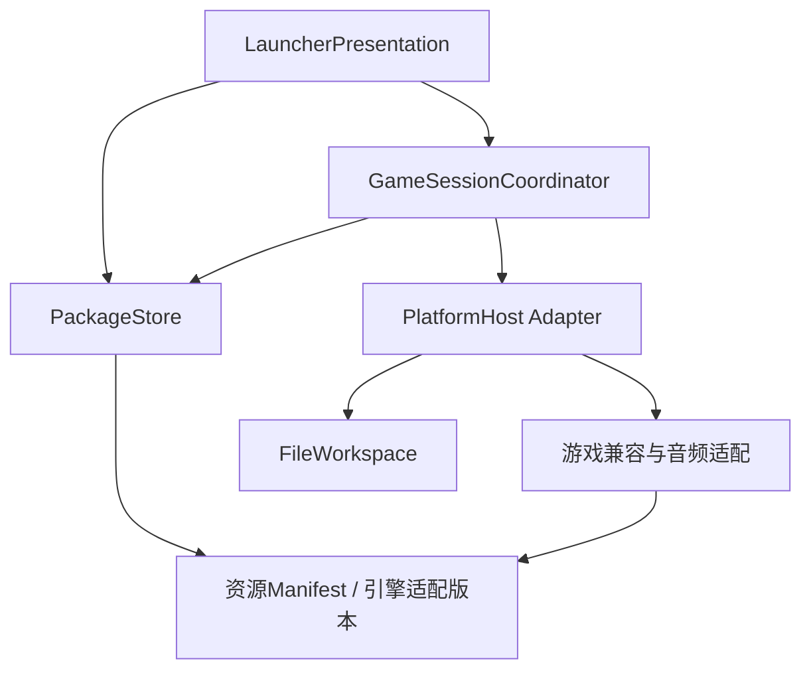

# GardendlessLoader 下一代设计

日期：2026-10-14。状态：设计与实施基线；生产实现尚未完成。依据：[两项目探索](../research/linked_projects_refactor_exploration_2026-10-14.md)。本设计中的性能目标是验收门槛，尚不是测量结果。

## 1. 目标、授权与默认行为

交付Android、iOS、纯血鸿蒙均可长期维护的本地游戏加载器，以及每个游戏新版可通过GitHub Actions一键生成的资源包。重构包括UI、资源管线、原生GameHost、共享兼容脚本、诊断与验证。用户已授权代理决定技术方案并修改游戏/引擎适配逻辑。

主验收设备：iPad Pro 2024、iPadOS 27，用户后续USB连接。另两端必须各有真机验收；iPad通过不能代替Android/ArkWeb结论。

默认保留：

- 现有游戏存档、localStorage/IndexedDB及GP-Next安装的Mod/补丁。
- 用户手动导入资源、离线启动、资源更新失败后仍可使用旧资源。
- 原版标准Web ZIP与配套工具生成的优化包；两者通过同一导入/会话接口使用，兼容包不擅自套用未知引擎补丁。
- 游戏玩法与存档语义、游戏内管理JS Modding、触摸/键鼠/导出工作流。
- 路径封闭、Origin/命令检查、非白名单请求阻断，密钥不进入资源包或仓库。
- 应用和资源包均可由Actions生成；应用更新提醒保持现有能力，不新增静默下载/安装系统。

优先级：数据正确与稳定播放 → 帧时长/内存可验证改善 → 可维护性 → UI视觉细节。操作系统最低版本先沿用现有支持声明；发现声明与调用不一致时修正兼容实现并验证，不能静默缩减平台范围。

## 2. 技术选择

| 选择 | 决定 | 原因 |
| --- | --- | --- |
| 启动器UI | Flutter，重写信息架构、页面状态和响应式布局 | 共享三端产品逻辑；游戏期FlutterEngine退出，三套原生UI缺少战斗性能收益证据 |
| 游戏运行时 | 系统WebView / WKWebView / ArkWeb，独立原生GameHost | 继续运行现有Cocos与GP-Next内容，保留各系统浏览器能力 |
| 平台实现 | Kotlin、Swift、ArkTS的小型Adapter | 保持系统API直接可调试，暂不引入跨三端FFI引擎或额外Web框架 |
| 共享逻辑 | 版本化契约、共同测试向量与小型JS运行时适配 | 共享语义和测试，避免复制大段业务或维护三份游戏补丁 |
| 状态管理 | 不可变状态快照、局部ValueListenable/ChangeNotifier | 当前规模不需要额外全局状态框架；UI只订阅相关状态 |
| 资源加工 | 确定性提取、内容清单、已验证引擎适配器 | 明确每个产物包含什么及支持什么，未知变化可诊断地失败 |
| 音频 | 先修复Cocos加载/失败语义，加入有预算的角色策略 | 已有更直接的缺陷证据；原生全接管会增加三端语义维护成本 |

沿用仓库CI的Flutter与OpenHarmony工具链固定版本起步，避免把框架升级与运行时重写混为一个实验。Flutter官方建议按可用空间进行自适应设计，区分展示状态与数据逻辑；此处选择简单的应用级模块，不机械复制所有架构层。[自适应设计](https://docs.flutter.dev/ui/adaptive-responsive/general)、[架构指南](https://docs.flutter.dev/app-architecture/guide)

## 3. 五个Module与所有权



| Module | Interface承担的行为 | 自己拥有的状态/生命周期 |
| --- | --- | --- |
| PackageStore | import、inspect、recover、acquireActive | A/B事务、元数据、资源验证、激活槽租约、旧目录迁移 |
| GameSessionCoordinator | start、consumeExit、cancelStart | 会话ID、固定资源身份/槽、设置快照、启动和返回状态 |
| PlatformHost Adapter | launch、readResource、close | WebView、资源队列、原生选择器、平台生命周期、请求取消 |
| FileWorkspace | openRead、write、commit、cancel、installArchive | GP-Next沙箱、传输句柄、字节预算、暂存和原子提交 |
| LauncherPresentation | 接受用户意图，提供页面状态 | 页面选择、弹窗、可见进度；更新/公告/诊断各自独立状态 |

每个Interface同时供调用者和行为测试使用。PackageStore内部可以拆事务和校验实现，但调用者不应理解extracting/readyToActivate的持久化细节。PlatformHost确有三种Adapter，三端差异在这里处理。保持文件职责集中，避免创建只转发一行的服务层。

会话是资源、传输和任务的所有者：每个任务必须携带sessionId与operationId；WebView退出会取消任务、关闭句柄、撤销读取URL、完成退出结果，随后释放激活槽租约。JS超时同样传播取消，不能仅移除Promise回调。正在使用的槽不可清理或复用。

## 4. 包契约与兼容

新资源ZIP由`docs/`、根目录`resource-manifest.json`、`file-index.json`和`reports/`组成。Loader现有应用事务manifest与资源包manifest名称/职责分离。

资源manifest至少包括：

- `schemaVersion`、游戏版本、Cocos版本、GP-Next识别结果。
- 上游repo/release/asset摘要，提取器commit与工具版本、构建参数、适配器ID及其ABI。
- `fileIndexSha256`，目标能力与所需最低host contract；可选能力和fallback分别声明。
- 音频清单摘要与策略版本、纹理变体及目标WebGL能力。

file-index按规范化安全相对路径排序，逐文件记录字节数与SHA256；只覆盖可供游戏读取的docs payload。清单自身和reports不进入该列表。**packageId由resource-manifest原始字节的SHA256计算，不把packageId写回被hash的manifest**；ZIP摘要放Actions外部产物描述中。Loader验证原始字节和清单digest，不重新序列化JSON计算身份，避免自指和不同序列化的歧义。

SHA用于内容一致性和复现，不代表Mod或资源来源认证。资源清单有大小/条目数/路径/重复项限制；未知schema主版本或未知必需feature明确拒绝。解压时逐块计算并核对文件digest，写入候选槽；拒绝未列payload、归一化冲突、穿越、链接、超限展开。全部验证和宿主自检通过才提交激活。legacy标准包由本地检测合成受限描述，标记未验证优化能力，继续走同一存储与启动Interface。

当前优化包的细粒度能力由运行前检查确认，如ASTC扩展、必要音频封装和bridge ABI。未满足host ABI或必需capability时拒绝该profile并给出可操作错误；仅可忽略声明为可选的扩展字段。普通图片fallback必须存在并被元数据正确引用，或者产物明确限制目标设备；仅保留原图文件不能称为fallback。

## 5. 引擎适配器

提取器注册表根据Cocos/引擎指纹识别已验证布局，转换操作以AST节点和语义前置条件定位；不再把正则命中次数当正确性证明。游戏虚拟模块通过稳定module ID和指纹访问，不在运行时硬编码R9/N9等压缩变量名。

每个adapter须验证：

1. 原始布局和语义前置条件满足；输入完整，补丁目标唯一。
2. 输出可解析；三条音频入口的行为、失败传播、显式选项与异步时序均执行测试。
3. 重复运行结果幂等；已处理版本可以核对后直接返回，不能二次叠加wrapper。
4. 输出hash与报告相符，全部候选文件完成后在新输出目录封存；不在源包上原地试错。
5. adapter声明支持的host ABI与资源能力，Loader不猜测缺失能力。

相同已验证引擎的新游戏内容版本应自动复用adapter。未知引擎可自动生成诊断候选、语法和结构报告；未注册为已验证布局时，即使通用smoke通过也不能签发正式优化包。没有通过兼容门禁时CI必须失败，不能上传命名为可安装资源包的产物。自动化降低重复工作，无法预先保证任意未来上游引擎变化零维护。

## 6. 音频方案与iOS替代入口

按用途区分BGM、短音效和长语音，同时保留caller显式模式；构建清单记录codec、容器、时长、声道和采样率等事实，运行时策略有版本并能说明选择原因。单个10秒阈值不再独占后端选择权。

加载必须等待声明的就绪条件，返回有限且正确的duration；错误、取消与超时分别完成，所有队列失败都可继续或明确结束。play、pause、seek、stop、destroy具有明确状态机，one-shot按实际ended/取消记账，并验证变速后结束事件与voice预算。播放数量和已解码PCM使用两个预算；并发解码合并同URL请求，失败Promise不悬空。

第一步保持三端现有页面Origin与资源入口，修复加载语义和观测盲区。iOS媒体Range历史问题已修复，不能用历史bug推导当前custom scheme必然不可用。[WebKit #203302](https://bugs.webkit.org/show_bug.cgi?id=203302)

如果修正后iOS长音频仍无法达到稳定性门槛，首个对照原型只把长音频映射到原生loopback HTTP端点，页面仍使用`gardendless-game://localhost`。原型必须验证跨Origin媒体、CORS/CSP、ATS、Range、seek、中断恢复及内存；只绑定loopback、每会话随机能力token、只读指定媒体、限制连接/在途字节，退出立即关闭。token不得进入持久日志、错误完整URL或导出报告；观察器只记录脱敏资源ID/资源相对路径，不能直接保留含token的pathname。原型不得顺带暴露Mod文件或安装命令。[WKURLSchemeHandler](https://developer.apple.com/documentation/webkit/wkurlschemehandler)、[NWListener](https://developer.apple.com/documentation/network/nwlistener)、[NSAllowsLocalNetworking](https://developer.apple.com/documentation/bundleresources/information-property-list/nsapptransportsecurity/nsallowslocalnetworking)

只有同一设备/文件A/B证明收益并通过行为门禁，才采用替代媒体入口；Android/OHOS不为了形式一致强制开服务器。原生BGM播放器为后续候选，须证明Cocos循环/seek/变速/结束事件等价；不会直接同时重写三端全部音频。

## 7. 有界文件与资源传输

控制消息只传命令、句柄、元数据与结果。大文件不再序列化为Native完整JSONArray/number[]并嵌入evaluateJavaScript。

| 消费者 | 传输Interface | 内存承诺 |
| --- | --- | --- |
| 浏览器图片/音频/脚本 | 同Origin受限资源URL，Native文件流 | Native读取块与并发有界；浏览器解码/缓存另计 |
| GP-Next必须取得Uint8Array | 会话绑定只读URL→二进制fetch | 可有一个受文件预算限制的最终JS完整数组；不声称全程流式 |
| ZIP安装与批量文件处理 | native归档任务/流式entry接口，由已验证GP-Next adapter调用 | 有界解压块、条目和展开预算，避免整个ZIP及全部结果同时跨桥 |
| JS写入 | 输入视图/Blob/stream按块发送、落盘确认后发下一块 | 禁止在分块前Array.from完整输入；fallback只编码当前小块 |

在固定session和gpNextRoot内解析所有句柄与路径。并发数、排队数、总在途字节、单操作大小、展开总量均有限；超限给结构化错误。后台IO、背压、幂等取消、顺序校验、临时写入和原子commit由FileWorkspace完成。并发读取和取消使用相同测试向量验证三端Adapter。

普通资源的MIME、容器嗅探、GET/HEAD/单Range/取消共用测试向量；Android以平台允许的响应方式表达缓存协商，不能直接构造304 WebResourceResponse。平台传输不必字节实现相同，但observable行为必须符合契约。

## 8. 新UI

视觉基线采用Apple原生应用的内容层级与系统无衬线字体，使用系统明暗配色。根据用户指定的[apple-design](https://github.com/emilkowalski/skills/blob/main/skills/apple-design/SKILL.md)与[emil-design-eng](https://github.com/emilkowalski/skills/blob/main/skills/emil-design-eng/SKILL.md)，先按任务重排完整功能，再决定材质与动效。详细功能矩阵、生产代码证据及布局取舍见[启动器功能与信息架构](launcher-information-architecture.md)。

产品分为四个稳定目的地，每个功能有唯一修改入口：

- **游戏**：当前游戏身份与资源状态、唯一开始游戏动作、自动收集与水印偏好、公告与来源。
- **资源**：唯一ZIP导入/更新动作、可取消的进度与详情、结果提示、资源根目录、校验/宿主状态、游戏版本与获取来源、技术详情。
- **日志**：持久化状态、刷新、等级/错误/操作筛选、完整事件、复制诊断、确认清理历史会话、唯一详细音频诊断开关。
- **设置**：加载器版本与获取来源、外观、减少动效、关于和使用说明。存档、Mod及JS Modding继续在游戏内管理。

全局仅有一个“检查更新”命令，同时检查加载器和游戏，各自显示结果与失败状态。版本显示为只读信息。完整日志不压缩成小Sheet，短确认和操作说明才使用模态面板。首选候选为顶部四项导航，另一候选为平板侧栏；二者功能一致，当前处于布局比较阶段。

启动器可随设备旋转，游戏横屏。手机将同一个导航重排到底部，将主动作独立成行；横屏按高度采用紧凑结构、内容可滚动。取消整页FittedBox缩放，实际触控尺寸至少48逻辑像素，字体随系统缩放并重排；覆盖SafeArea、大字体、键盘与读屏。

动效以状态反馈和空间关系为目的：按钮按下立即反馈，高频导航直接切换，偶发面板过渡约150–250ms。手势交互才考虑可中断的弹簧；不以固定时长弹跳模拟原生手感。正式实现按Flutter与平台能力选择。减少动态效果、减少透明度与高对比分别处理；不使用持续粒子、漂浮或自动轮播。原生dialog负责模态焦点和返回，异步状态改变应保留展开内容与合理焦点，导入中禁止重复提交。

资源是否可启动和导入操作状态是独立变量：旧资源ready与新包validating可以同时成立。候选导入失败后明确显示旧版本可用；只有激活槽身份未恢复或有活跃提交事务时阻止启动。Session starting防重复点击，退出后恢复页面和设置。

交互预览用示例资源表达状态转换，不连接设备、不读取存档，也不代表性能已验证。当前布局演示沿用导入期间禁止启动的生产交互，后续按任务所有权实现并验证上面的独立状态模型。正式Flutter UI根据确定的流程实现，预览HTML不作为生产依赖。

## 9. Actions一键工作流

保留两个仓库。资源项目提供默认完整验证的`workflow_dispatch`；Loader保留APK、未签名IPA、未签名arm64 HAP构建。新增组合维护者入口可通过固定commit的reusable workflow调用资源构建，并在同一次运行串联应用构建与兼容检查；使用`workflow_call`参数与outputs，在跨job需要文件时显式传artifact。[GitHub reusable workflows](https://docs.github.com/en/actions/how-tos/reuse-automations/reuse-workflows)

跨仓调用时，reusable workflow里的默认checkout仍检出调用者仓库，`github.sha`也不能当作extractor源码身份。提取job必须显式设置`repository/ref/path`检出extract固定commit，并从该checkout读取extractorCommit；固定`uses@SHA`不等于已经检出那份提取源码。artifact归属同一次caller run，outputs传artifact名/ID和包摘要，下游按这些结果读取，不猜其它仓库的run ID。

常用操作只需选择目标上游release（可留空）并点击Run。默认策略固定并记录，普通发包不要求逐次决定音频模式、阈值或纹理参数。保持既有入口并映射到新管线，避免强制用户学习新的复杂工作流。

```mermaid
flowchart LR
  dispatch[Run workflow] --> resolve[解析并锁定上游release/digest]
  resolve --> extract[提取到新输出目录]
  extract --> adapter[识别/转换/验证adapter]
  adapter --> profile[音频与纹理能力策略]
  profile --> contract[清单/hash/包验证]
  contract --> smoke[真实引擎行为与宿主契约smoke]
  smoke --> package[封存资源ZIP与诊断报告]
  package --> apps[构建APK / IPA / HAP]
  apps --> bundle[版本与兼容报告 + 下载产物]
```



CI正常成功必须包含三端应用产物和资源产物；缺OpenHarmony工具配置时组合发布失败并说明缺项，不能把“跳过HAP”称为三平台发布完成。iOS/HarmonyOS仍需用户签名安装，现有签名secrets保持兼容。构建成功与真机验收分开标记；后者完成才可声明该设备/系统已验证。

工具和跨仓ref固定版本/commit，记录源码身份、输入摘要、产物摘要与兼容关系；失败保留诊断，不保留秘密或游戏资源到Git。资源ZIP通过用户手动获取/导入继续分发，不把游戏资源嵌进应用仓库。

## 10. 验收与测量

| 维度 | 最低验收 |
| --- | --- |
| 三平台功能 | 同一支持资源完整启动、触摸、Mod/存档导入导出、退出和恢复 |
| 音频稳定性 | 同一包100次BGM启动/切换/循环与30次前后台，实际可听输出和事件一致；无加载悬空/无声失败 |
| 高负载稳定性 | 固定大量怪物关卡连续1小时，3次独立运行；无renderer退出，保存完整退出/错误证据 |
| 生命周期 | 20次切关、20次进入/退出游戏，任务/句柄关闭，内存稳定值不随循环持续增长 |
| 性能改善 | 同包/同场景/同温度条件测p50/p95帧时长、>100ms长帧、声音首响延迟；基线噪声范围外的改善才计入结果 |
| 内存改善 | 按工具能力采集宿主/renderer；PCM为估算，GPU及内存归属结合Instruments/系统报告，无法可靠分拆时标unavailable；稳定/峰值与退出后回落分别比较 |
| 数据迁移 | 旧存档与Mod可读，失败导入保留旧槽，迁移可重试且不清旧Origin数据 |
| UI | 手机横竖屏、平板、200%字体、安全区与48逻辑像素操作目标可用 |
| 一键发包 | 支持上游版本无需修改脚本即可Run生成三端应用和资源ZIP；未知adapter失败时有确定诊断 |

先在指定iPad建立可重复基线，再锁定各场景的帧预算/内存阈值；不强行承诺60FPS，也不在没有测量时虚构内存上限或提升百分比。Android与鸿蒙设备的验收数据分别建立。模拟器、Node、静态字符串测试不能代替codec/GPU/音频中断的真机门禁。

诊断默认低频汇总：设备/内核、包/adapter身份、请求/解码计数、PCM估算、媒体就绪/错误、会话退出。详细事件有采样/限流；诊断开关引起的成本须单独测量。

## 11. 结构、风格与验证命令

实现沿用`lib/src/`、`assets/game_bridge/`、三平台目录与`test/`。PackageStore及SessionCoordinator放业务逻辑路径，页面按开始/诊断/设置拆分；契约与测试向量放`contracts/`，适配器放提取项目`scripts/`的明确模块。原有代码保留为行为参考，替换按小切片接入，不对旧目录执行批量删除。

```dart
class SessionStartRequest {
  const SessionStartRequest({required this.packageId});

  final String packageId;
}
```

Dart两空格、单引号、UpperCamelCase类型、lowerCamelCase成员；命名描述领域行为，错误使用稳定code并带operationId。

现有可用验证命令：

```sh
flutter analyze --no-pub
flutter test
node tool/check_audio_diagnostic.mjs
node tool/check_game_bridge.mjs
node tool/check_touch_patch.mjs
swift test --package-path ios/GardendlessKit
flutter build apk --release
flutter build ios --release --no-codesign
```

OpenHarmony用专用SDK和现有override后执行`flutter build hap --release --target-platform ohos-arm64`。新管线实施时新增本地与CI共用的确定性验证入口；本文不把尚未实现的命令写成可用命令。

本会话明确的删除规则继续适用。含递归清理的现有测试先建立无删除fixture运行方式；不能直接运行那些清理，也不能为了绿灯跳过真实失败。更改CI/依赖/技术选型在用户授权范围内；不发消息给他人，不自动发布Release，不提交密钥，不改签名身份或覆盖用户存档。

## 12. 实施顺序

1. 固化包身份与三端共用测试向量；建立真实0.15回归夹具的外部摘要引用，不提交游戏资源。
2. 修复并执行验证音频加载/失败/显式模式与observer，建立iPad运行采样；用同场景确定传输替代原型是否必要。
3. 接入有所有权和预算的文件/资源任务，按完整Mod安装和退出取消路径验证三端。
4. 重写Flutter页面与状态，接入新的PackageStore/SessionCoordinator；保持每个切片可运行。
5. 迁移并验证持久化数据、旧资源与升级恢复；完成三端真机矩阵。
6. 将确定的契约和adapter接入两个仓库默认Actions与组合入口，校验产物和版本说明。

技术选型无需再逐项交给用户决定。若出现无法同时满足的产品取舍，例如必须放弃存档格式或某平台能力，提供具体证据和可评估方案后再确认。下一阶段实际设备连接是性能验收输入，当前不宣称软件已重构或目标已达成。

## 13. 本轮设计验证记录

三名独立代理分别评审运行时/音频、资源管线/Actions、UI/状态及文件传输。已落实跨仓checkout显式固定、未知contract/adapter拒绝行为、loopback token脱敏和指标可获取性限制。

界面交互预览在本机浏览器检查了1280宽布局、390宽手机布局和320宽窄屏。两个方案在320宽时无水平溢出，可见按钮宽高均至少48像素；设置页详细音频开关可在诊断页反映，导入预览能进入校验并回到就绪状态，未观察到脚本error/warn。预览仅使用本地示例状态，没有读取设备或游戏数据。

此前单页Apple视觉稿已做过320/1024宽度、明暗主题与导入交互检查，但其重复入口和功能覆盖未满足用户要求。当前以完整功能矩阵与四目的地布局取代该稿；新布局的验证记录统一维护在[启动器功能与信息架构](launcher-information-architecture.md)，不能把旧稿的检查结果套用到新稿。

预览插画由内置imagegen生成，仅存于当前聊天的visualization目录；真实游戏logo只用于预览，未加入应用仓库。当前交互预览替换先前的同名预览，旧稿保留为v1备份，没有删除文件。

这些检查不覆盖正式Flutter渲染、200%字体、实际平板旋转、三端系统无障碍或游戏运行性能；这些仍按第10节验收。
