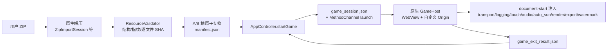

# GardendlessLoader 功能机会探索

日期：2026-10-18。分支：`compat/gardendless-0.15-and-later`（基于 `8538073`）。状态：只做了探索和提案，没有修改生产代码。

## 0. 先说结论

这个加载器的正确性底座已经很扎实：A/B 双槽事务、路径封闭、原生日志、错误目录和三端一致的 JS 桥都已就位。它真正欠缺的是**"游戏外"的那一圈体验**：游戏意外中断后怎么接住玩家、导入前能否提前告知会不会失败、诊断信息够不够定位问题，以及让人愿意回来的一点个人记录和仪式感。

最值得先做的 6 项都只需要改 Dart，或在三端原生里各加几十行，不新增依赖：

| ID | 功能 | 一句话理由 | 成本 |
| --- | --- | --- | --- |
| A1 | 游戏中断感知 | 进程在游戏中被杀后，"快速启动"会直接把玩家送回同一个崩溃现场 | S（纯 Dart） |
| A2 | 崩溃后降档重试 | renderer 退出目前只弹一条提示；"降低渲染分辨率"这个现成解法离它两页远 | S（纯 Dart） |
| C1 | 诊断信息补全 | WebView 内核版本在诊断里**永远**是 `unavailable`；提取器 commit 校验后被丢弃 | S–M |
| C3 | 游戏会话健康摘要 | 回到启动器后，玩家不知道刚才记录了错误；日志页没有任何角标 | S |
| A4 | 导入完成后一步开玩（附剩余时间估计） | 导入成功 2 秒后提示消失，玩家还得自己找回游戏页 | S |
| B3 | 版本升降级时刻 | 升级时给一个有仪式感的"新芽时刻"；降级时提醒存档风险（这一半很实用） | S |

下文每条建议都附有代码证据。凡是无法从代码确认的点，都标注为**待验证**。

## 1. 探索范围与可信度

已通读或追踪：README（中/英）、`AGENTS.md`、`pubspec.yaml`、`lib/` 全部入口与控制器、四个页面、模型、服务（导入/校验/更新/公告/快捷方式/设置）、`assets/game_bridge/` 全部 10 个脚本、iOS `GameHostController` 和 `GardendlessKit` 的导入与限制部分、Android `GameActivity`/`GameWebViewClient`/`GameBridge`、OHOS `GamePage`、日志事件目录与错误目录，以及 `docs/architecture/`、`docs/research/`、`tasks/` 下的现有设计文档。

未逐行阅读：三端的 GP-Next 文件系统实现细节、资源 scheme handler 内部、OHOS 导入插件。这些部分与本文建议关系不大。

本文没有做真机运行。所有涉及帧时长、黑屏时长和手势误触的判断，都是**待验证**的推断。

> 关于任务说明：原任务说明在"如果项目涉及浏览器、iPad Safari、桌面"处被截断。本项目不是浏览器或桌面应用，而是 Android WebView / iOS WKWebView / OHOS ArkWeb 三端原生宿主。iPad 通过 WKWebView 原生宿主支持，不经过 Safari。因此本文把"iPad 专项"落在实体键盘、边缘手势和刘海安全区这些真实存在的宿主行为上。

## 2. 项目画像

**定位**：一个本地资源加载器，用于在手机和平板上离线运行 PvZ2 Gardendless 的 Web 构建（标准 Cocos 包或 GP-Next 包）。它不分发游戏资源，由用户手动导入 ZIP。

**目标用户**：
- 想在移动端玩 Gardendless 的玩家，以中文用户为主，核心场景是 iPad 和 Android 平板横屏。
- 会装 GP-Next Mod 的进阶玩家。
- 维护者本人。资源包由配套仓库 `extract-pvzge-gpnext` 通过 Actions 生成。

**运行链路**：

**启动器**：Flutter 实现，横屏布局，有四个目的地（游戏 / 资源 / 日志 / 设置）。各项偏好有明确归属：`app_settings.json` 存放水印、快速启动、渲染分辨率、主题、语言、减少动效和音频诊断；自动收集存放在资源 manifest 里。

## 3. 现有能力盘点

### 已完整实现

- ZIP 导入，包括系统选择器、"用本应用打开/分享"和桌面快捷方式三种入口。导入过程分阶段显示进度，带速度和耗时；导入期间保持屏幕常亮。
- A/B 槽事务、启动时恢复中断事务、旧槽延后清理，以及从旧版目录结构迁移。
- 资源校验：必需目录和文件、标题与 pvzge 指纹、Cocos settings、GP-Next 功能指纹；新格式包还会校验 manifest、file-index 和**逐文件 SHA-256**。
- 原生 GameHost：路径封闭、非白名单网络阻断、renderer 退出检测、退出结果回传。
- JS 桥能力：触摸转鼠标（单指、双指右键、双指滚轮）、iOS 音频会话恢复、存档导出接管、GP-Next Tauri 适配、自动收集阳光、渲染分辨率上限、水印。
- 结构化原生日志：持久化或内存降级、按等级和 Operation 筛选、复制单条事件或完整诊断、删除历史；"上次运行未正常结束"由三端原生检测。
- 错误目录：60 多个错误码，每个都有中英文标题和**修复建议**，任何失败提示都会附带对应建议。
- 加载器与游戏的更新检查（GitHub Release 与上游 tags），可按 tag 暂缓提醒；远程公告与"关于"内容带缓存回退。
- 中英双语、浅色/深色/跟随系统、减少动效、刘海/传感器位置感知的安全区。

### 已写好但用户触达不到的能力

| 能力 | 现状 | 证据 |
| --- | --- | --- |
| 触摸轨迹诊断 | JS 已实现 256 条环形缓冲和快照接口，但三端都硬编码为 `false`，也没有任何代码读取快照 | [touch_input_adapter.js:8](../../assets/game_bridge/touch_input_adapter.js)；[GameHostController.swift:731](../../ios/Runner/GameHostController.swift)、[GameActivity.kt:143](../../android/app/src/main/kotlin/io/github/dey410/gardendlessloader/game/GameActivity.kt)、[GamePage.ets:213](../../ohos/entry/src/main/ets/pages/GamePage.ets) |
| WebView 内核版本 | `diagnostics()` 预留了 `webViewEngineVersion` 参数，但所有调用点都没传，诊断里恒为 `unavailable` | [app_controller.dart:916](../../lib/src/app_controller.dart)、[diagnostics_service.dart:19](../../lib/src/services/diagnostics_service.dart) |
| 提取器身份 | 资源包 manifest 必须包含 `cocosVersion` 和 40 位 `producerCommit`，校验通过后却没有写入应用 manifest，诊断里也看不到 | [resource_validator.dart:211](../../lib/src/services/resource_validator.dart) |
| `systemTerminated` 退出原因 | Dart 和 Android 都定义了这个枚举，但三端没有任何路径会写入它 | [game_session_store.dart:11](../../lib/src/game_host/game_session_store.dart)、[GameBridge.kt:209](../../android/app/src/main/kotlin/io/github/dey410/gardendlessloader/game/GameBridge.kt) |
| 错误"可恢复"标记 | `UserLogError.recoverable` 已为每个错误码标注，但 UI 从未读取 | [log_event_catalog.dart:962](../../lib/src/logging/log_event_catalog.dart) |
| 游戏运行态 | `auto_sun.js` 已经能读到"关卡进行中"和"已暂停"两个状态，目前只用于自动收集 | [auto_sun.js:103](../../assets/game_bridge/auto_sun.js) |
| 会话时长 | sessionId 前缀就是启动时刻（微秒），退出结果里有 `finishedAt`，单次游玩时长可以直接算出来，但没有被使用 | [app_controller.dart](../../lib/src/app_controller.dart) `_newGameSessionId`、[game_session_store.dart](../../lib/src/game_host/game_session_store.dart) |

## 4. 观察到的问题与机会（附证据）

1. **进程被杀后会陷入快速启动循环。** `consumeExitResult()` 在"有 prepared 会话但没有退出结果"时返回 `null`（[game_session_store.dart:95-97](../../lib/src/game_host/game_session_store.dart)），而快速启动的条件正是 `exitResult == null`（[app_controller.dart:262](../../lib/src/app_controller.dart)）。于是 iOS 内存回收或 Android 杀进程之后，下次打开会**跳过启动器直接回到游戏**，玩家也看不到任何"上次中断"的提示。三端都没有接内存压力回调。
2. **renderer 崩溃之后只有一条提示。** `rendererGone` 退出只会显示错误标题和修复建议（[app_controller.dart:248](../../lib/src/app_controller.dart)）。最常见的诱因是显存或内存不足，而现成的解法"渲染分辨率 1.5×/1×"（[app_settings_store.dart:32](../../lib/src/services/app_settings_store.dart)、[render_scale.js](../../assets/game_bridge/render_scale.js)）藏在设置页里。
3. **导入不预检剩余空间。** 一个资源包大约 1.08 GB（8523 个文件，见 `.refactor-session.md` 的实测记录）。更新期间新旧两个槽会同时存在。原生层在解压前已经从中央目录算出了解压总量（[ZipImportSession.swift:92](../../ios/GardendlessKit/Sources/GardendlessImport/ZipImportSession.swift)），但全仓库没有任何剩余空间检查。空间不足时，玩家会在解压到一半时得到一个 `zip_write_failed`。
4. **退出游戏缺少防误触。** Android 的 `onBackPressed` 和 OHOS 的 `onBackPress` 都是按一次就退出（[GameActivity.kt:429](../../android/app/src/main/kotlin/io/github/dey410/gardendlessloader/game/GameActivity.kt)、[GamePage.ets:185](../../ohos/entry/src/main/ets/pages/GamePage.ets)）。iOS 的左缘手势在识别开始时就触发退出，没有判断手势状态（[GameHostController.swift:181-186, 236](../../ios/Runner/GameHostController.swift)）。PvZ 的种子栏恰好在屏幕左侧。**待验证**：真机上拖种子时是否会误触这个手势。
5. **存档提示只是一段文字。** 更新前的确认框只建议"先进游戏导出存档"（[app_strings.dart:338](../../lib/src/l10n/app_strings.dart)），既没有"去导出"按钮，也不知道玩家上次导出是什么时候。导出本身全程经过原生层（`export_download_patch.js` → `file:begin destination: export`），所以原生层是知道导出何时成功的。
6. **诊断只能复制到剪贴板**（[home_page.dart:492](../../lib/src/ui/home_page.dart)）。完整诊断包含全部近期事件，体积可能很大。**待验证**：QQ、微信等聊天软件粘贴长文本时是否会截断。
7. **错误发生后很难被注意到。** 侧栏只有资源页和设置页有角标，日志页始终没有（[home_page.dart:596-618](../../lib/src/ui/home_page.dart)）。游戏里记录的 JS 错误、资源 404 和音频失败，玩家如果不主动打开日志页就不会知道。
8. **导入完成后的衔接断开。** 成功 2 秒后进度会自动复位（[app_controller.dart:638, 820](../../lib/src/app_controller.dart)），玩家还停留在资源页，需要自己找到"开始游戏"。
9. **缺少可量化的性能证据。** v2 设计把 p50/p95 帧时长和长帧列为验收门槛（[loader-v2-design.md §10](../architecture/loader-v2-design.md)），但运行时没有任何帧时长采样。音频已经有一套"60 秒汇总、限流"的观察器（[audio_diagnostic.js](../../assets/game_bridge/audio_diagnostic.js)）可以照搬。
10. **启动器缺少"人"的痕迹。** 它不记得你上次什么时候玩、玩了多久、经历过哪些版本。`lastImportAt` 每次导入都会被覆盖，版本历史因此全部丢失。

## 5. 功能建议

每条建议都注明了**落点**，即这个功能的唯一入口。这与现有设计"每个功能只有一个修改入口"的原则（[launcher-information-architecture.md](../architecture/launcher-information-architecture.md)）保持一致。成本分三档：S 约半天到一天，M 约 2–4 天且涉及三端，L 需要更多设计或验证。

### A. 实用性

#### A1 游戏中断感知（P0 · S · 纯 Dart）

- **解决什么**：问题 1 描述的快速启动循环，以及玩家对"刚才发生了什么"一无所知的状态。
- **现有基础**：`game_session.json` 在每次启动前写入，正常退出时连同退出结果一起被清理。因此"prepared 会话还在、退出结果不在"就足以说明上次游戏是被系统或玩家强行结束的。
- **做法**：在 `GameSessionStore` 中增加对这种状态的识别，读到后删除 prepared 文件，返回一个 `interrupted` 结果。`initialize()` 遇到这种结果时**本次不快速启动**，并在游戏页显示一张恢复卡片："上次游戏意外中断（可能是系统回收了内存）"，提供 [继续游戏] 和 [降低画质后继续]（复用 A2）两个按钮。
- **落点**：游戏页主区域，与开始按钮放在同一行。不新增页面。
- **待验证**：Android 进程被杀后，系统是否会从最近任务里直接重建 `GameActivity`。如果会，就需要在 `LaunchRouterActivity` 补一条判断，但 Dart 侧的识别逻辑不受影响。

#### A2 崩溃后降档重试（P0 · S · 纯 Dart）

- **解决什么**：问题 2，renderer 退出后玩家不知道该怎么办。
- **做法**：遇到 `rendererGone` 退出，或 A1 识别出的中断，且当前渲染分辨率为 `full` 时，恢复卡片提供 [降至 1.5× 并开始游戏]：一键写入设置，然后启动游戏。如果已经是 1.5×，就建议降到 1×。如果已经是最低档，就只提供"重新开始"和"查看日志"。
- **为什么不是自动降档**：自动降档会悄悄改变用户的设置，而且现在还没有证据证明每次崩溃都是内存造成的（C5 补上这部分证据后可以再评估）。让玩家点一下，既是最小改动，也保持透明。
- **落点**：A1 那张恢复卡片。设置页仍然是渲染分辨率的唯一常驻入口。

#### A3 导入前剩余空间预检（P0 · M · 三端原生）

- **解决什么**：问题 3，空间不足时导入失败在半路。
- **做法**：原生层在读完中央目录后，比较 `解压总量 × 1.05 + 余量` 与可用空间：iOS 用 `volumeAvailableCapacityForImportantUsage`，Android 用 `StatFs`，OHOS 用 `statfs.getFreeSize`。空间不够就在**解压之前**以新错误码 `storage_insufficient` 失败，并带上"需要 X，可用 Y"。错误目录新增一条修复建议："清理空间后重试，旧资源不受影响"。
- **注意**：更新时旧槽仍然占着空间，计算的是新增需求，不能扣掉旧槽。不能用"先删旧槽"来腾空间，因为那会破坏"失败时旧资源仍可用"的保证。
- **待验证**：iOS 的 "important usage" 容量包含可清理的缓存，偏乐观，需要真机确认误判率。

#### A4 导入完成后一步开玩，附剩余时间估计（P1 · S）

- **解决什么**：问题 8，以及大包导入时玩家不知道还要等多久。
- **做法**：导入成功时，在进度卡的完成状态里放一个 [去游戏] 按钮（只负责导航，不直接启动，保持"开始游戏"在游戏页的唯一归属），同时用现有的 `HapticFeedback` 给一次轻触反馈。解压阶段根据已有的平滑速度 `bytesPerSecond`（[import_progress_meter.dart:36](../../lib/src/services/import_progress_meter.dart)）显示"预计剩余 mm:ss"，只在速度稳定后显示。
- **落点**：资源页导入卡片。

#### A5 存档安全感（P1 · S–M）

- **解决什么**：问题 5，"建议备份"只停留在文字上。
- **第一阶段**：原生层在导出成功提交时记录 `lastExportAt`，复用 `game_exit_result.json` 回传，或单独写一个小文件。更新确认框据此显示"上次导出存档：3 天前"或"还没有导出过"，并提供 [先进入游戏导出] 按钮，直接开始游戏。
- **第二阶段（待验证后再决定）**：在沙箱里保留最近 N 份**游戏自己导出的文件**副本，供"导出到别处后弄丢了"时找回。这不算新增存档格式，与 [loader-runtime-contracts.md:48](../architecture/loader-runtime-contracts.md) 的约束不冲突，但需要先确认导出通道里是否只有存档。
- **待验证**：`destination: export` 和 `host:export` 是否也会被 GP-Next 用于导出非存档文件；游戏存档实际保存在 localStorage 还是 IndexedDB、使用什么键名（代码和文档中都没有记录）。

#### A6 防误退出（P1，若误触属实则升为 P0 · S/端）

- **解决什么**：问题 4。
- **做法**：
  - Android/OHOS：第一次按返回时，显示原生 Toast "再按一次返回启动器"，2 秒内再按一次才退出。
  - iOS：只在手势结束时退出，并要求水平位移超过阈值（例如 80pt）；拖动过程中在左缘显示一个跟随手指的半透明"返回"提示，松手才生效。
- **待验证**：先用 B1 打开触摸诊断，或者直接让测试者拖左侧种子栏，确认误触真实存在后再改。

#### A7 iPad 实体键盘快捷键（P2 · S）

- **做法**：游戏内用 `UIKeyCommand` 注册 ⌘W（或长按 Esc）返回启动器。启动器用 Flutter `Shortcuts` 注册 Enter 开始游戏、⌘O 导入。Android 和 OHOS 的实体键盘可以接同样的映射。
- **理由**：使用说明已经写明"实体鼠标和键盘交由 WebView 原生处理"，但接了键鼠的用户没法用边缘手势退出，现在只能伸手去摸屏幕。

#### A8 按需重新校验资源完整性（P1 · S）

- **解决什么**：游戏里出现贴图缺失或白块时，没有手段判断是资源损坏还是游戏 bug。
- **做法**：在资源页技术详情里加一个 [重新校验]，在 isolate 中对激活槽执行一次 `ResourceValidator.validate`。新格式包会逐文件比对 SHA，旧标准包只做结构检查（这一点要在界面上写明）。结果写回 `lastSelfCheckAt`，失败时给出出问题的文件和错误码。可以与 C3 联动：本次游戏出现资源 404 时，日志摘要直接给出这个入口。
- **落点**：资源页 →"技术详情"折叠区，属于低频的高级操作。

### B. 趣味与辨识度

设计约束：不加常驻粒子、漂浮动画或自动轮播（[loader-v2-design.md §8](../architecture/loader-v2-design.md)）；所有动效都遵守"减少动效"；不使用 EA 或 PvZ 的版权台词和角色。

#### B1 花园工具棚：彩蛋式开发者模式（P2 · S–M）

- **玩法**：在侧栏的应用图标上连点 7 次，出现"你发现了工具棚 🪴"，日志页随即多出一个"工具棚"区块。
- **里面放什么**：全部是**已有但隐藏**的能力。包括：触摸轨迹诊断开关（把三端硬编码的 `false` 改为由会话配置传入，退出时用 `evaluateJavaScript` 取回快照并写入日志）、详细音频诊断（可从日志页迁入或在此镜像显示）、原始 `manifest.json`、`game_session.json` 和 WebView UA 的只读查看，以及 B7 的启动时间线。
- **价值**：既是彩蛋，又能降低维护者远程排障的成本。遇到问题时可以直接告诉用户"点图标 7 次，打开触摸记录再复现一次"。
- **落点**：日志页，只在解锁后可见；再连点一次图标即可隐藏。

#### B2 花园日记：本地游玩记录（P1 · S–M）

- **内容**：累计游玩时长、游玩次数、最长一次、上次游玩时间；按版本记录"版本年轮"，每次导入追加一条，包含游戏版本、GP-Next 版本、包大小和日期。
- **现有基础**：单次时长 = `finishedAt` − 会话启动时刻（建议在会话 JSON 里显式加一个 `startedAt` 字段，不要去解析 sessionId）。导入成功时 manifest 已经携带版本信息。
- **存储**：新增一个有界的 `journal.json`，汇总值加最近 30 次导入。数据只保存在本地，不上传。
- **呈现**：游戏页标题下的副信息改为"上次游玩 昨天 21:30 · 42 分钟"；资源页"游戏版本"卡下方用一条横向年轮时间线展示版本更迭，时间线是静态的，只在新增一节时播放一次生长动画。
- **可选延伸**：基于真实事件的里程碑，例如"第一次导入""累计 10 小时""经历 5 个版本"。只建议在日记上线且确实受欢迎之后再做，不要为了徽章而做徽章。

#### B3 版本升降级时刻（P1 · S）

- **升级**：导入的版本高于原版本时，完成卡显示"0.14.2 → 0.15.0 🌱"，配一次性的新芽动画，并附"查看上游更新记录"链接（指向已在使用的 `pvzg_site` tags 来源）。
- **降级（这一半很实用）**：导入前在原生层读出包 manifest 中的 `gameVersion`，如果低于当前版本，就在确认框里明确提醒"新版本写过的存档可能无法被旧版本读取，建议先导出存档"。版本比较复用 [game_update_check_service.dart:97](../../lib/src/services/game_update_check_service.dart) 的 `_compareVersions`（需要改为公开方法）。
- **待验证**：旧标准包没有 manifest，只能在校验后从标题或 GP-Next 模块中取得版本，降级提醒对这类包需要放到"切换之前"的环节实现。

#### B4 等待时的一条小贴士（P2 · S）

- 每次导入时，在进度区下方显示**一条**随机贴士，不轮播。贴士内容由原创文案和功能发现组成，例如："双指轻点就是右键"、"画面卡顿？试试设置里的渲染分辨率"、"Mod 会在游戏里执行代码，只装可信来源的"。
- 价值在于把导入的几十秒等待变成功能导览。贴士库写在 `app_strings.dart`，与现有的双语结构一致。

#### B5 节日微主题（P3 · S–M · 远程驱动）

- 在 `announcements.json` 中可选地增加 `theme: {accent, badge, from, to}`：在日期范围内替换强调色，并在标题旁加一个小徽记（比如 10 月底的 🎃、春节的 🧧）。纯静态，不加粒子。
- 理由：公告通道已经是远程、限大小、限 https 的，加一个可选字段就能做节日活动，不需要发版。`Announcement.fromJson` 只读取已知键，旧版本会忽略新字段，保持向后兼容（**待验证**：确认没有严格模式的 schema 校验）。

#### B6 首次进游戏的手势提示（P2 · S）

- 由 Dart 在会话配置里传入 `showGestureHint: true`（只在第一次启动游戏时为 true）。注入一个与 `watermark.js` 同构的小脚本，在角落显示 3 行半透明提示：单指点拖、双指点右键、双指滑滚轮。提示设置 `pointer-events: none`，收到第一次触摸或 6 秒后淡出。
- 理由：触摸映射是加载器自己的设计，目前只写在设置页的使用说明里，玩家进游戏时并不知道。

#### B7 启动过场：先测量，再决定（测量 P1 · S；过场 P2 · M）

- **第一步（测量）**：补齐启动里程碑日志，依次为 点击开始 → 宿主创建 → 页面开始加载 → 页面加载完成 → 画布首帧或 Cocos 就绪，记录在同一个 gameSessionId 下。其中"页面开始/完成"事件三端已经都有。
- **第二步（只有黑屏确实明显时才做）**：在原生 GameHost 上叠加启动器同款海报（已打包的 `launcher_poster.png`）和一行"正在唤醒花园…"，等到首帧后淡出。
- **待验证**：各端从点击到 Cocos 开屏的实际黑屏时长；可用的就绪信号，例如 `cc.game` 的初始化事件或第一次 canvas 绘制。

### C. 稳定性与开发者体验

#### C1 诊断信息补全（P0 · S–M）

在诊断摘要中补上以下字段：
- **WebView 内核版本**：Android 用 `WebView.getCurrentWebViewPackage()?.versionName`，iOS 取系统版本（WebKit 跟随系统），OHOS 取 ArkWeb 版本或默认 UA。通过现有 MethodChannel 读取一次即可。
- **资源包身份**：`cocosVersion`、`producerCommit` 写入应用 manifest。有了提取器 commit，就能精确复现是哪一版提取器产出的包。
- **设备型号、当前渲染分辨率档位、剩余存储**（A3 的 API 可以复用）。
- **上次游戏退出原因和时长**（来自 A1 与 B2）。

理由：README 把"不同 WebView 的行为差异"列为已知限制，却恰好拿不到 WebView 版本。这是排障时信息价值最高的一组字段。

#### C2 诊断导出为文件并调用系统分享（P1 · M）

- 在"复制诊断"旁边加一个 [分享诊断文件]：生成 `gardendless-diagnostics-<时间>.txt`，交给系统分享面板（iOS `UIActivityViewController`，Android `ACTION_SEND` + FileProvider，OHOS 分享能力）。
- 文件中的路径需要脱敏，把用户名部分替换成 `~`。

#### C3 游戏会话健康摘要和日志角标（P1 · S）

- 回到启动器时，按上一个 gameSessionId 统计 ERROR/FATAL 事件数，并按类别汇总（脚本错误、资源请求失败、音频失败）。有错误就在日志导航上显示数字角标，并在游戏页给出一行摘要："本次游戏记录到 2 个资源缺失 · 查看"。
- 对资源类错误，直接给出 A8 [重新校验] 的入口；对 `recoverable == false` 的错误码，引导用户反馈问题（C7）。这样 `recoverable` 字段也终于有了用处。

#### C4 帧时长采样摘要（P1 · S–M）

- 新增 `render_diagnostic.js`，照搬 `audio_diagnostic.js` 的模式：用 `requestAnimationFrame` 的帧间隔填充固定桶直方图，不逐帧记录日志；每 60 秒和 `pagehide` 时上报一次 `render_summary`，包含 p50、p95、>50ms 和 >100ms 的长帧数、采样时长、当前 DPR 上限，以及游戏是否处于关卡中（复用 `auto_sun.js` 的状态读取方式）。
- 价值：直接服务 v2 设计 §10 的验收表，让"同场景对比渲染分辨率档位"有了数据来源。后续也可以据此给出"关卡中 p95 偏高，建议降至 1.5×"之类的建议，但要等数据可信之后再做。
- **待验证**：采样本身的开销，需要在 iPad 上对比开关前后的表现。

#### C5 内存压力事件（P1 · S）

- 接入 iOS 的 `didReceiveMemoryWarning`、Android 的 `onTrimMemory(level)` 和 OHOS 的 `onMemoryLevel`，按现有日志格式写入 `memory_pressure` 事件（带 gameSessionId 和级别）。
- 价值：为 A2 的"崩溃是不是内存造成的"提供因果证据，C3 的会话摘要也可以显示"本次收到 3 次内存警告"。

#### C6 一键反馈问题（P2 · S）

- 在日志页加一个 [反馈问题]：打开 `github.com/Dey410/GardendlessLoader/issues/new`，标题预填最近的错误码，正文预填版本、平台和 WebView 版本（这些不是个人数据），**不把日志或路径放进 URL**。同时提示用户把"诊断文件"（C2）作为附件上传。
- 仓库需要配套新增 `.github/ISSUE_TEMPLATE/bug.yml`。

## 6. 推荐路线

| 批次 | 内容 | 特点 |
| --- | --- | --- |
| 第一批 | A1、A2、C1、C3、A4、B3（降级提醒） | 几乎全是 Dart 改动，不改协议；直接减少"玩家卡住"和"维护者猜原因" |
| 第二批 | A3、A6（先真机确认误触）、A8、C4、C5、B2 | 需要三端各做小改；这批做完后，稳定性有数据可看，启动器也开始记得玩家 |
| 第三批 | C2、B1、A5、B7、B4、B6、A7、C6、B5 | 体验打磨和彩蛋；B7 和 A5 第二阶段依赖待验证项 |

每一批都按 `AGENTS.md` 的要求，用 `flutter analyze`、受影响平台的构建和真机清单来验证，不重新加回 Flutter 测试。涉及共享 JS 的项目（C4、B6）沿用 `tool/check_*.mjs` 的 Node 校验方式。

## 7. 明确不建议做的

| 想法 | 不做的原因 |
| --- | --- |
| 自动下载或静默更新游戏资源 | 项目立场是不分发游戏资源；v2 设计明确"不新增静默下载/安装系统" |
| 保留多个版本、一键回滚 | 每个槽约 1 GB；契约规定成功后清理旧槽；资源能回滚，存档却不能。替代方案是在 B2 的年轮里标出版本，让用户自行重新导入旧 ZIP |
| 在加载器里管理或启停 Mod | GP-Next 已经在游戏内负责，README 也明确写了；再做一套会形成两个真相来源 |
| 常驻 FPS 悬浮窗 | 会干扰游戏画面并增加开销；C4 的会话摘要已经能回答性能问题，悬浮显示最多放进 B1 工具棚 |
| 云存档 | 需要服务器、账号和隐私方案；GP-Next 的 `cloud_journal_read` 在这里本来就返回 null |
| 更多游戏内辅助（自动种植、加速等） | `auto_sun.js` 已经依赖游戏内部模块 ID，扩展只会增加脆弱性；这类功能属于 GP-Next Mod 的领域 |
| 动态背景、粒子、自动轮播 | 违反现有设计约束，而且耗电 |
| 新的存档格式或 Loader 侧存档库 | 违反 [loader-runtime-contracts.md:48](../architecture/loader-runtime-contracts.md) |

## 8. 待验证清单

1. 游戏存档的实际存储位置（localStorage 还是 IndexedDB）和键名（影响 A5 第二阶段）。
2. 导出通道是否只用于存档（影响 A5）。
3. iOS 左缘手势和 Android 返回键的误触频率，重点是左侧种子栏的拖拽（影响 A6）。
4. Android 进程被杀后系统是否会恢复 `GameActivity`（影响 A1 的检测入口）。
5. 各端从点击开始到 Cocos 开屏的黑屏时长，以及可用的就绪信号（影响 B7）。
6. 长诊断文本粘贴到 QQ/微信时是否会被截断（影响 C2 的优先级）。
7. rAF 采样在 iPad 上的开销（影响 C4）。
8. iOS 剩余空间 API 的乐观偏差（影响 A3 的余量取值）。
9. `announcements.json` 增加字段后，旧版本客户端是否确实会忽略（影响 B5）。

## 9. 本文遵守的约束

- 每个功能只有一个入口，不在同一页面重复放置同一个动作（见 IA 文档）。
- 最小改动，在因果链断开的地方修复；不加兜底和冗余抽象（维护者偏好）。
- 不重新引入 Flutter 单元或组件测试（`AGENTS.md`）。
- 保留路径封闭、非白名单请求阻断和 A/B 原子切换（`AGENTS.md` 安全章节）。
- 与 ADR-0002（三端统一使用 JS 触摸适配器）无冲突：B1 只打开已有的诊断开关，B6 是纯展示脚本，都不改变触摸路由。
