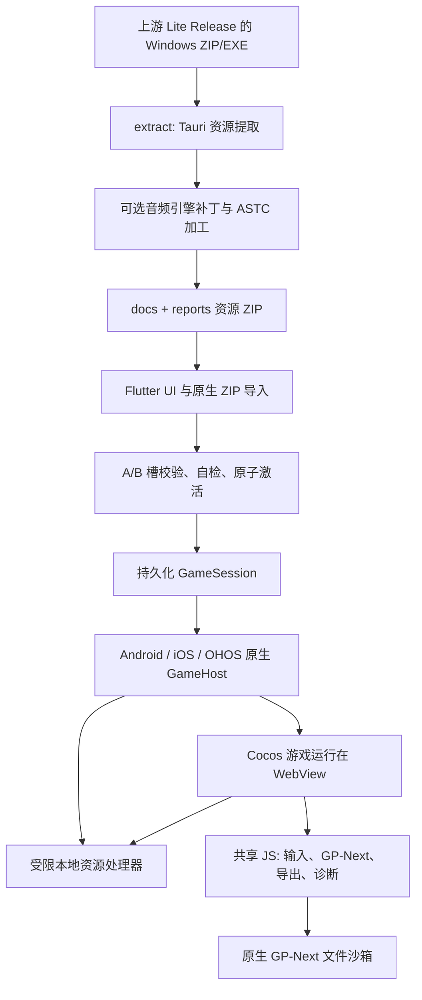

# 两项目完整重构前的探索报告

日期：2026-10-14，Asia/Shanghai。范围：GardendlessLoader 与 extract-pvzge-gpnext 的联动架构、UI、资源加工、音频、性能、内存、生命周期、测试与发布。此轮新增调查文档，没有修改生产代码、导入资源或提交 Git 变更，没有执行文件删除。

用户目标是两个项目完整重构，包含 UI。当前代表性反馈为 **iOS、Loader 0.8.2、游戏资源 0.15，短音效正常而 BGM 缺失，大量怪物时存在性能或内存问题**。BGM 是首启缺失还是运行中消失尚不确定；设备型号、系统版本、关卡、用户实际资源 ZIP 的摘要及现场内存数据仍未取得。

## 1. 结论与证据等级

目前有明确的跨项目缺陷和设计边界，但没有证据支持用一个原因解释全部版本的所有症状。后续完整重构应分别验收 UI、资源产物、宿主传输、游戏运行时和数据迁移。

| 发现 | 证据等级 | 对重构的意义 |
| --- | --- | --- |
| 音频补丁覆盖调用者指定的 DOM/WebAudio 模式 | 真实 0.15 引擎片段的隔离执行已复现 | 音频策略必须有明确归属及可验证的优先级 |
| DOM loader 在 metadata 前 resolve，Cocos 可以保存 NaN 时长 | 真实片段与模拟未就绪媒体元素已复现 | 保留加载完成、错误、超时与 duration 的语义 |
| 直接 loadNative 入口出现 `returnR9` 粘连并抛 ReferenceError | 真实 0.15 片段执行已复现；常规 BGM 未证实调用此入口 | 正则命中次数和字符串测试不足以验证生成代码 |
| 三平台 GP-Next 文件读取形成完整数组和 JSON 响应 | 原生代码与共享 JS 已核实 | 为大文件定义端到端传输、并发及字节预算 |
| Android Resolver 的 304 直接传入不接受 3xx 的 WebResourceResponse | 源码与官方 API 契约已核实 | 统一行为契约时必须尊重平台能力 |
| iOS 音频观察器只在 window 捕获媒体事件 | 源码与 DOM 规范已核实；本次未做真机 DOM 探针 | 离屏 Audio 的加载/错误可能漏报，诊断缺失不能证明成功 |
| 当前 UI 用 FittedBox 整体缩放最小 980×680 画布 | 源码已核实 | 新 UI 应采用按空间重排的布局及实际触控尺寸验收 |
| 大量怪物时涉及游戏 update、渲染、音效及缓存 | 实际游戏 bundle 有候选路径，未取得 CPU/GPU/内存 profile | 必须测量瓶颈，重写启动器无法保证游戏循环改善 |

“已复现”指明确的隔离代码行为，不等于已经在用户 iPhone 上复现 BGM 故障或 OOM。四份报告中的资源体积、理论 GPU/PCM 容量均与真机常驻内存严格区分。

分项证据见：

- [提取管线、真实包与音频调用链](extract_pipeline_exploration_2026-10-14.md)
- [Android 宿主、资源、导入与文件桥](android_host_exploration_2026-10-14.md)
- [iOS/OHOS 宿主、缓存、诊断与游戏运行层反证](ios_ohos_host_exploration_2026-10-14.md)

## 2. 调查基线和版本识别

| 项目 | 本地基线 | 远程核对 | 调查开始时已有改动 |
| --- | --- | --- | --- |
| GardendlessLoader | `compat/gardendless-0.15-and-later@b6152704b22e2137efa4da1a542f76c6eb896ca8`，pubspec 0.8.2 | main 为 `95395bf24d38ec0907d596fcf9400e00fd1148ca`；v0.8.2 发布于 2026-10-05 01:16，三平台产物齐全 | 未跟踪的 `docs/releases/`，未触碰 |
| extract-pvzge-gpnext | `codex/dom-metadata-preload@1ffb59b061761ccee1592097abc78c63fc9a6bda` | 默认 main 与近期实际构建分支不同；最近成功构建使用当前分支 | 两个已修改的 .DS_Store，未触碰 |

只读 GitHub compare 显示 Loader 远程 main 比本地基线多 12 个提交、8 个差异文件：三份 README、announcements、发布文档、`js_modding.js`、相应 JS 检查脚本及 asset 测试。**本次关注的 Dart 和三平台原生实现没有差异**，但整棵发布树不能描述为完全相同。[compare](https://github.com/Dey410/GardendlessLoader/compare/b6152704b22e2137efa4da1a542f76c6eb896ca8...95395bf24d38ec0907d596fcf9400e00fd1148ca)、[v0.8.2 release](https://github.com/Dey410/GardendlessLoader/releases/tag/v0.8.2)

提取器历史存在全 DOM、混合 DOM/WebAudio、metadata preload、依赖原生 facade 等不同政策。仅“游戏 0.15”不足以识别产物。Downloads 中的 0.13/0.14/0.15 是本机参考样本，尚未经用户确认就是设备当前导入的 ZIP；0.15 ZIP SHA256 为 `47febd56947fe5e4a513938cf5e5a4566c2c68ad0fc5d6acdb1ae2152c7cd0dd`，引擎 SHA256 为 `030b9c1a89dd49a6cda9aa3460743046abf58d79c3d4a9f91275db262632d5a2`。完整包摘要、参数和设备激活槽仍须对齐。

## 3. 实际系统结构



提取项目是 **上游编译产物的提取和后处理工具**。它没有可重新构建整款游戏的 Cocos 工程或完整原始 TypeScript。当前 Loader 是启动器、资源事务系统、三平台 Web 宿主与文件适配器；战斗 update、Cocos 渲染和多数音频播放逻辑在导入资源中。

iOS 启动 GameHost 后销毁 FlutterEngine；Android 结束 FlutterActivity 并由 embedding 销毁自建引擎；OHOS 启动独立 GameAbility 后终止 launcher Ability。因此应把启动交叠峰值、游戏运行峰值和退出恢复分别测量。iOS 的游戏期性能不能用 Flutter UI profiler 代替。[iOS AppDelegate:160–175](../../ios/Runner/AppDelegate.swift)、[Android 证据](android_host_exploration_2026-10-14.md)、[OHOS 证据](ios_ohos_host_exploration_2026-10-14.md)

### 启动器和资源事务

- `AppController` 1142 行，协调初始化、路径、资源导入恢复、设置、公告、应用/游戏更新、日志与启动，构造器包含较多依赖注入和调度参数。`home_page.dart` 2787 行，包含资源页、日志页、公告、更新、启动控件和通用视觉组件。行数是边界梳理线索，本身不是掉帧证据。[AppController](../../lib/src/app_controller.dart)、[HomePage](../../lib/src/ui/home_page.dart)
- 导入实际解压在平台侧，Dart `ImportService` 管理 extracting → validating → selfChecking → readyToActivate → cleaningOldSlot → idle。激活前保存元数据和 manifest，清理失败可延后恢复，旧资源在激活前仍可用。[ImportService:44–245](../../lib/src/services/import_service.dart)
- 启动恢复可重建丢失 manifest、完成待激活候选、重试旧槽清理并迁移 legacy current/previous。完整重构需要明确保留的数据安全行为，不能仅复制正常启动页面。[ImportService:248–610](../../lib/src/services/import_service.dart)
- 资源校验读 HTML、settings、入口及引用的 GP-Next 模块；自检确认关键路径封闭与可打开。它不是 codec、WebGL ASTC、真实音频播放或全资源完整性验收。[ResourceValidator](../../lib/src/services/resource_validator.dart)、[ResourceSelfCheck](../../lib/src/services/resource_self_check.dart)
- `gp-next` 位于双槽外；更新游戏资源应保持安装的 Mod 与补丁。稳定 Origin 对 localStorage/IndexedDB/游戏存档也有迁移意义。[GameSession](../../lib/src/game_host/game_host.dart)、[README](../../README.zh-CN.md)

## 4. 音频：最需要贯通两个仓库的契约

### 4.1 当前实际加工

提取 workflow 默认启用混合音频，图片默认 none；当前不调用遗留 `transcode-assets.sh`，因此不能把历史 24 kbps/mono 转码参数归给所有当前包。脚本以 10 秒为阈值，长音频与探测失败走 DOM，短音频走 WebAudio；分流完全覆盖调用者的 `audioLoadMode`。[patch_audio_runtime.py:75–100、152–203](/Users/xiaozhu_410/Documents/Code/extract-pvzge-gpnext/scripts/patch_audio_runtime.py:75)

真实 0.15 参考包有 215 个 DOM、3972 个 WebAudio 音频。241 条命名 music 资源中，167 条走 DOM、74 条短 intro/outro 等走 WebAudio。因此“BGM”不是一个统一播放后端，后续需分别观察长 MP3、长 M4A 和短音乐过场。[样本明细](extract_pipeline_exploration_2026-10-14.md)

游戏 SoundManager 本身显式把音乐 clip 设为 DOM；提取补丁会再次覆盖该选择。Loader 当前只提供资源并让 Cocos 播放，没有原生音频引擎。音频政策分散在游戏声明、构建清单、Cocos 后端和平台媒体能力之间，这是首要设计接缝。[当前音频架构](../architecture/cocos-audio-pipeline.md)

### 4.2 已证实的加载语义问题

DOM loader 设置 `preload=metadata`、src、调用 load，随即 resolve；原有 metadata/canplay/error/timeout 等等待被移除。实际 Cocos downloader 随即把 player.duration 写入 clip meta。隔离执行中未就绪元素的 NaN 被保存，随后 player.duration 变正常也不会自动改变该 meta。

这能影响读取 getDuration 的插入曲时长和默认音效冷却。普通 BGM loop 还依赖自己的 JSON musicLength，部分 clip 可能自带 duration，所以不能推导所有音乐必然失败。直接 loadNative 的 `returnR9` 缺陷也已复现，但常规音频加载走另一入口；二者应分别建立行为测试。[最小复现与实际调用路径](extract_pipeline_exploration_2026-10-14.md)

### 4.3 观测和生命周期

iOS 观察器只在 window 捕获媒体加载、ready、playing、ended、error。Cocos 创建而未挂到 DOM 的 Audio 元素不经过 window 事件路径；prototype.play 包装仍能观察调用/拒绝，但不足以覆盖未播放前的加载失败。观察器也没有 loadedmetadata、readyState、networkState、media.error.code、AudioContext 状态或 PCM 大小。[audio_diagnostic.js:158–240](../../assets/game_bridge/audio_diagnostic.js)、[DOM event dispatch](https://dom.spec.whatwg.org/#concept-event-dispatch)

Android/OHOS 没有同等音频观察器。详细 iOS 音频事件未经普通 JS 日志的每分钟限流，每条都经过请求/回复桥。应建立低开销、三平台可比较的观测契约，避免用开启大量日志的结果直接代表正常性能。[平台调查](ios_ohos_host_exploration_2026-10-14.md)

真实引擎已有 48 voice 上限和同 tick 音效去重；不能描述为没有音效控制。待测接缝包括 one-shot 变速后的结束计时、decode 错误外层 Promise 是否结束、DOM destroy 的取消、播放队列失败后是否继续，以及后台/中断恢复。48 voice 限制不等于已加载 PCM 总量受限。[音频生命周期分析](extract_pipeline_exploration_2026-10-14.md)

## 5. 内存：四个不同的预算

| 层 | 已观察到的表示/行为 | 应采集的证据 |
| --- | --- | --- |
| 原生资源传输 | Android 文件流；iOS/OHOS 128 KiB 读取块；iOS另有24 MiB小音频缓存 | 活跃/排队请求、吞吐、等待、取消和宿主内存 |
| GP-Next文件桥 | 完整字节数组、JSON、JS字符串与解析结果；写入前先Array.from完整数据 | 单次峰值、队列总字节、UI线程耗时、退出取消 |
| WebAudio/Cocos资源 | 解码AudioBuffer、clip/cache引用、音源节点 | PCM估算字节、缓存引用、重复解码、切关后回落 |
| 图片与GPU | 图集、ASTC或解码RGBA、纹理和渲染目标 | 当前上传纹理、GPU压力、解码峰值、资源释放 |

### GP-Next 的确定放大路径

三平台 read_file 最终都整量回传。iOS Data → UInt8数组 → JSON → evaluateJavaScript；Android JSONArray 的序列化在 UI 线程；OHOS 虽分64 KiB读取仍累积完整 number[]。写入按96 KiB请求分块，但共享兼容层先对完整输入 Array.from，因此单条消息限制不代表全过程常驻内存有界。[iOS/OHOS文件桥](ios_ohos_host_exploration_2026-10-14.md)、[Android文件桥](android_host_exploration_2026-10-14.md)、[兼容序列化](../../assets/game_bridge/gp_next_compat_bridge.js:33)

独立算术实验：1 MiB、字节值均匀覆盖0–255的数据，转十进制JSON数组后为 **3,743,745字节，约3.57倍**。这个数只包含编码文本，未计数组对象、转义、Native/JS两侧副本。它不是实测App内存倍数。

```sh
node -e 'const n=1024*1024; const data=Uint8Array.from({length:n},(_,i)=>i%256); const text=JSON.stringify(Array.from(data)); console.log(JSON.stringify({binaryBytes:n,jsonAsciiBytes:Buffer.byteLength(text),jsonToBinaryRatio:Buffer.byteLength(text)/n}));'
```

该路径主要影响 Mod/文件工作流；没有 Mod 大文件操作的战斗场景不能直接归因于它。Android每请求新线程、三平台pending总数缺少容量边界及取消传播，适合在新文件协议中统一治理。

### 音频和纹理总量

WebAudio AudioBuffer 是32-bit float PCM，理论payload为 `秒数 × 采样率 × 声道数 × 4`，磁盘压缩码率不能代替解码内存预算。例如180秒、48kHz双声道约65.9 MiB，只是计算示例。[Web Audio规范](https://www.w3.org/TR/webaudio/#AudioBuffer)

0.15参考包608张ASTC合计706,395,232字节；若按各图尺寸全换成RGBA level0，算术总量约5.59 GiB。两者均为全包合计，**没有证明同时驻留**。样本有4096×4096图集，单张RGBA约64 MiB、4×4 ASTC约16 MiB。ASTC元数据只指向ASTC，保留原图不构成无支持设备的自动fallback；平台能力必须进入资源契约。[纹理处理与样本表](extract_pipeline_exploration_2026-10-14.md)

## 6. 大量怪物时的性能边界

独立检查实际0.15游戏bundle发现已有NodePools、每种name池超过100时clear、多个切场景clearAll/资源卸载，以及Zombie disable时停止tween、清登记和buff。完整重构应保留这些行为证据，避免以“没有回收”作为未经验证的重写理由。

候选CPU路径包括CharacterManager每帧最左僵尸选择中的复制/随机sort/filter/sort，以及Zombie逐lane植物过滤、碰撞和排序；音频侧也有每帧数组复制、去重和cooldown处理。怪物多时可能同时增加CPU逻辑、动画/draw call、音效和纹理访问。这里还没有采样证据说明谁是主要瓶颈。[独立反证及定位](ios_ohos_host_exploration_2026-10-14.md)

[Issue #25](https://github.com/Dey410/GardendlessLoader/issues/25)确认一次iOS WebContent终止，维护者评论判断内存问题；记录没有Jetsam或内存曲线，因此具体归属尚未证明。`rendererGone`回调本身可能由多种原因触发。[Apple终止回调](https://developer.apple.com/documentation/webkit/wknavigationdelegate/webviewwebcontentprocessdidterminate(_:))

建议固定一个存档/关卡，比较相同怪物数量下的音频开关、原图/ASTC和Mod配置；每次只改变一个变量。测p50/p95帧时长、长帧、CPU/GPU、宿主与WebContent内存、切关后稳定值以及声音失败事件。新框架的名称不能代替这些验收数字。

## 7. UI 与应用边界

当前UI已有明暗主题、资源导入进度、公告、应用/游戏更新、日志过滤与复制、启动设置。重构应先明确这些功能的用户流程与保留要求，随后才确定视觉风格和技术栈。

最具体的布局问题是固定画布缩放：最小980×680、外边距12；在不扣SafeArea的915×412约束下，scale约0.571。设计为56×72的启动箭头最终约32×41逻辑像素；实际SafeArea可能让它更小。字体与其它控件也随整体缩小。这是源码公式推导，未取得本次设备截图。[布局:286–313](../../lib/src/ui/home_page.dart:286)、[按钮:2299–2331](../../lib/src/ui/home_page.dart:2299)

当前主页由一个AnimatedBuilder订阅总AppController，导入ticker/进度及日志状态会触发整页构建。它是可拆分的状态边界；没有Flutter frame trace，不能把它宣布为已测UI瓶颈。[HomePage:49](../../lib/src/ui/home_page.dart:49)、[import ticker](../../lib/src/app_controller.dart:776)

候选新边界可以是启动器UI/展示状态、资源事务、会话生命周期、文件工作流、可观测性与更新服务。UI应按可用空间重排，资源导入、就绪、错误恢复和游戏启动各有清晰状态；开发诊断可以保留独立入口。是否继续Flutter、改三端原生UI或采用其它技术，需要用户决策与原型验证，本报告没有预先选择。

## 8. 应写成明确协议的联动内容

| 契约 | 目前状态 | 重构时要消除的隐含约定 |
| --- | --- | --- |
| 资源身份 | title/指纹、reports和版本号分散 | 同一版本不同提取分支、参数和引擎补丁无法唯一识别 |
| 音频政策 | 游戏模式被构建清单覆盖 | 角色/能力/错误/时长/就绪条件的优先级 |
| 纹理能力 | ASTC引用改写；Loader不协商设备支持 | 无支持设备与fallback、GPU预算 |
| 本地资源 | 三种Origin、不同MIME嗅探及取消实现 | 相同行为测试向量及允许的平台差异 |
| 文件桥 | Tauri兼容命令、请求上限、部分写入chunk | 读响应、总传输预算、取消、并发和生命周期所有者 |
| 持久化 | A/B槽、GPNext目录、稳定Web存储Origin | 升级迁移、崩溃恢复和用户存档可继续访问 |
| 诊断 | 事件catalog、iOS专有音频观察 | 设备/内核/资源身份、媒体状态及低开销采样 |

现有安全与数据行为包括激活槽路径封闭、Origin/命令限制、非白名单请求阻断与导入原子切换；这些应成为新实现的可执行验收条件。README另要求只使用可信来源Mod，这是一项使用约束，当前实现没有鉴定或认证Mod来源。[原生资源研究](native_gamehost_local_resource_loading.md)、[验收清单](../acceptance-checklist.md)

现有ADR-0002规定三端统一JavaScript触摸适配器；当前音频架构规定Loader交由Cocos播放。若新方案改为原生触摸或原生音频，应显式替代记录并验证兼容性，不能在重写中默默改变。[ADR-0002](../adr/0002-use-javascript-touch-adapters-on-all-platforms.md)、[音频架构](../architecture/cocos-audio-pipeline.md)

## 9. 本轮验证与限制

以下六个只读源码/内存VM行为检查均通过：

```text
node tool/check_audio_diagnostic.mjs
node tool/check_game_bridge.mjs
node tool/check_touch_state_machine.mjs
node tool/check_touch_patch.mjs
node tool/check_auto_sun.mjs
node tool/check_export_download_patch.mjs
```

提取侧另通过shell语法检查；在禁用临时目录清理、保留夹具的执行方式下，31个Python测试中16通过、15因缺Pillow跳过。真实引擎片段的路由、提前完成/冻结时长和returnR9问题另有隔离复现。原命令、替代执行方式和边界见[提取调查](extract_pipeline_exploration_2026-10-14.md)。没有运行完整Cocos游戏、codec解码或ASTC设备验收。

没有运行Flutter/Swift/Gradle完整测试或构建：部分现有测试会递归清理临时目录，本会话删除规则要求不能执行这些清理。当前通过的mock/字符串检查不证明真机音频与性能正确。

ADB daemon监听受sandbox限制，iOS devicectl等待CoreDeviceService初始化超时，未得到可用真机profile。额外浏览器合成事件探针因data URL策略限制未执行；未绕过限制，离屏媒体诊断结论依据源码与DOM规范，未标记为浏览器实测。

## 10. 下一阶段的交付顺序候选

以下是供grill-me讨论的候选顺序，尚未确认正式重构方案：

1. 固定设备、资源ZIP/引擎摘要、Loader发布基线和一个关卡，建立音频、帧时长、内存及恢复的验收基准。
2. 明确平台优先级、历史资源/存档/Mod兼容范围，以及是否允许修改游戏运行层或只能修改宿主/构建产物。
3. 把新资源manifest、文件传输、会话生命周期、音频政策与能力协商写为跨仓契约，先验证高风险接缝。
4. 为UI的信息架构与响应式交互做可评估原型，为宿主/音频选择做同场景对照原型，再决定最终实现。
5. 逐能力实现新软件并持续与基线比较，最后验证升级迁移、三平台差异与发布产物。

初次探索时，完整重构是用户已提出的目标，技术与产品边界仍在grill-me讨论中。后续已确认的约束见下节；技术选型现由代理负责。

## 11. 探索后的用户确认

2026-10-14，用户明确：

1. Android、iOS、纯血鸿蒙必须完整保留。
2. 允许重构两个项目、UI、资源加工与游戏适配逻辑，技术方案由代理决定。
3. 唯一产品目标是更稳定、更流畅、更易维护地玩游戏。
4. 保留GitHub Actions一键为新版生成应用和游戏资源包的维护者工作流；不将此扩展为应用内静默自更新。
5. 真机主验收设备为iPad Pro 2024、iPadOS 27；用户会在后续验收时通过USB连接，目前不宣称设备已接入。

默认保留现有存档、GP-Next Mod、标准Web资源兼容入口、离线游戏与现有安全约束。广泛技术授权不改变本会话明确的文件删除安全规则。
